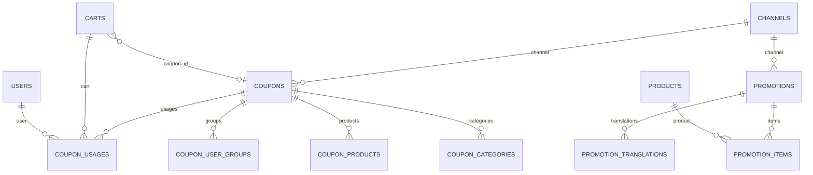

# Database — Coupons and Promotions

Module index: [README.md](./README.md)

Column types below come from migrations, not model guesses.

---

## Table: `coupons`

### Purpose

Coupon definitions.

### Created By

`database/migrations/2025_08_29_195534_create_coupons_table.php.php`

Channel column: `database/migrations/2026_06_05_120000_add_channel_id_to_coupons_table.php`

### Columns

| Column | Type | Nullable | Default | Description |
| ------ | ---- | -------- | ------- | ----------- |
| `id` | bigint PK | no | | |
| `channel_id` | foreignId | yes | null | `constrained()`, `cascadeOnDelete()`, after `id` |
| `code` | string(64) | no | | unique |
| `name` | string(191) | yes | | |
| `description` | text | yes | | |
| `type` | string(32) | no | `by_percent` | |
| `amount` | decimal(12,2) | no | 0 | |
| `status` | string(32) | no | `active` | |
| `usage_limit` | unsignedInteger | yes | | |
| `usage_limit_per_user` | unsignedInteger | yes | | |
| `starts_at` | timestamp | yes | | |
| `ends_at` | timestamp | yes | | |
| `min_subtotal` | decimal(12,2) | yes | | |
| `max_subtotal` | decimal(12,2) | yes | | |
| `max_discount_amount` | decimal(12,2) | yes | | |
| `allow_guest` | boolean | no | true | |
| `stackable` | boolean | no | false | Comment in migration: future-use, single coupon applied now |
| `conditions` | json | yes | | |
| `batch` | string(64) | yes | | indexed |
| `created_at` / `updated_at` | timestamps | yes | | |

### Primary Key

`id`

### Foreign Keys

- `channel_id` → `channels.id` cascade on delete (added 2026-06-05)

### Indexes / Unique

- unique `code`
- index `batch`

---

## Table: `coupon_user_groups`

Same create migration as `coupons`.

| Column | Type | Notes |
| ------ | ---- | ----- |
| `coupon_id` | FK cascade | |
| `user_group_id` | FK cascade | |

Primary key: `(coupon_id, user_group_id)`.

---

## Table: `coupon_products`

| Column | Type | Notes |
| ------ | ---- | ----- |
| `coupon_id` | FK cascade | |
| `product_id` | FK cascade | |

Primary key: `(coupon_id, product_id)`.

---

## Table: `coupon_categories`

| Column | Type | Notes |
| ------ | ---- | ----- |
| `coupon_id` | FK cascade | |
| `category_id` | FK cascade | |

Primary key: `(coupon_id, category_id)`.

---

## Table: `coupon_usages`

### Created By

`database/migrations/2025_08_29_195618_create_coupon_usages_table.php.php`

### Columns

| Column | Type | Nullable | Default | Description |
| ------ | ---- | -------- | ------- | ----------- |
| `id` | bigint PK | no | | |
| `coupon_id` | FK cascade | no | | |
| `cart_id` | FK to `carts`, nullOnDelete | yes | | |
| `order_id` | unsignedBigInteger | yes | | Comment: “future (orders)”. No FK. |
| `user_id` | FK nullOnDelete | yes | | |
| `email` | string(191) | yes | | |
| `amount_discounted` | decimal(12,2) | no | 0 | |
| `status` | string(32) | no | `applied` | Comment: applied, consumed, cancelled |
| `ip` | string(64) | yes | | |
| `user_agent` | text | yes | | |
| `created_at` / `updated_at` | timestamps | yes | | |

### Indexes

- `(coupon_id, status)`
- `(user_id, coupon_id)`
- `(email, coupon_id)`

---

## Table: `carts` (coupon columns only)

Owned by [cart-checkout](../cart-checkout/README.md). Added by `database/migrations/2025_08_29_195759_add_coupon_to_carts_table.php.php`:

| Column | Type | Nullable | Default |
| ------ | ---- | -------- | ------- |
| `coupon_id` | FK to `coupons`, nullOnDelete | yes | |
| `coupon_code` | string(64) | yes | |
| `coupon_discount` | decimal(12,2) | no | 0 |

`App\Models\Cart::$fillable` does **not** list these columns. They are assigned as attributes (`CouponService`) or via `forceFill` (`CartController::clear`).

---

## Table: `orders` (coupon columns only)

Owned by [orders](../orders/README.md). From `database/migrations/2025_09_01_145651_create_orders_domain.php.php`:

| Column | Type | Nullable | Default |
| ------ | ---- | -------- | ------- |
| `coupon_code` | string(64) | yes | |
| `coupon_discount` | decimal(12,2) | no | 0 |

Written from the cart in `OrderService` on place-order.

---

## Table: `promotions`

### Created By

`database/migrations/2026_05_26_100000_create_promotions_tables.php`

### Columns

| Column | Type | Nullable | Default | Description |
| ------ | ---- | -------- | ------- | ----------- |
| `id` | bigint PK | no | | |
| `channel_id` | FK nullOnDelete | yes | | |
| `title` | string | no | | |
| `slug` | string | no | | unique |
| `description` | text | yes | | |
| `banner_image` | string | yes | | |
| `icon` | string | yes | | |
| `logo` | string | yes | | |
| `status` | string(32) | no | `active` | |
| `starts_at` | timestamp | yes | | |
| `ends_at` | timestamp | yes | | |
| `created_at` / `updated_at` | timestamps | yes | | |

---

## Table: `promotion_translations`

| Column | Type | Nullable | Notes |
| ------ | ---- | -------- | ----- |
| `id` | bigint PK | no | |
| `promotion_id` | FK cascade | no | |
| `locale` | string(10) | no | |
| `title` | string | yes | |
| `slug` | string | yes | |
| `description` | text | yes | |
| timestamps | | yes | |

Unique: `(promotion_id, locale)`.

---

## Table: `promotion_items`

| Column | Type | Nullable | Default | Description |
| ------ | ---- | -------- | ------- | ----------- |
| `id` | bigint PK | no | | |
| `promotion_id` | FK cascade | no | | |
| `product_id` | FK cascade | no | | |
| `price` | decimal(12,2) | yes | | Unused by current sync (always null) |
| `special_price` | decimal(12,2) | yes | | |
| `special_from` | date | yes | | |
| `special_to` | date | yes | | |
| `position` | unsignedInteger | no | 0 | |
| timestamps | | yes | | |

Unique: `(promotion_id, product_id)`.

Promotion specials are also copied onto `product_prices` (catalog-owned table). See [workflows.md](./workflows.md).

---

## Entity relationships

