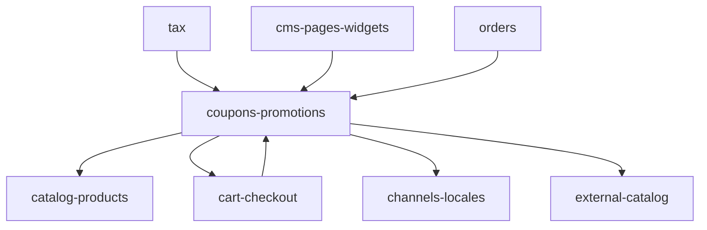

# Dependencies — Coupons and Promotions

Module index: [README.md](./README.md)

Verified from imports and call sites. Sibling module READMEs are written in parallel; links assume those folders exist.

```text
coupons-promotions
├── depends on
│   ├── catalog-products
│   ├── cart-checkout
│   └── channels-locales
│
└── consumed by
    ├── cart-checkout
    ├── tax
    ├── cms-pages-widgets
    ├── catalog-products (write-back of specials / projections)
    ├── orders
    └── external-catalog (revalidate ping)
```



---

## Depends on: `catalog-products`

| Evidence | Path |
| -------- | ---- |
| Coupon product/category/attribute scoping | `Coupon`, `ValidatesCouponScoping`, `CouponService::eligibleCartItemProductIds` (`product_categories`, `product_attribute_values`) |
| Admin product search on coupon form | `admin.products.search` in `resources/views/admin/coupons/_scoping.blade.php` |
| Promotion items → `Product`, `ProductPrice` | `PromotionItem`, `PromotionService`, `PromotionController::productPricing` |
| Projection rebuild | `ProductProjectionService` |
| Price history | `ProductPriceHistoryRecorder` → `product_price_history` |
| `PromotionProductResource` images/translations | `Product` relations |

Do not treat catalog-rules as a hard import of this module. Cart unit prices may already include catalog-rule prices before coupon math; that lives in `CartService::effectiveUnitPrice` (cart-checkout + catalog-rules).

---

## Depends on: `cart-checkout`

| Evidence | Path |
| -------- | ---- |
| `CouponService` namespace and `Cart` usage | `app/Services/Checkout/CouponService.php` |
| Cart coupon columns | migration `add_coupon_to_carts_table` |
| Apply/remove HTTP | `CartController`, `CartService` |
| Totals after apply | `CartService::recalcTotals` |
| Usage consume | `OrderService` (checkout → orders) |

`CouponService` is physically under Checkout but is this module’s coupon engine.

---

## Depends on: `channels-locales`

| Evidence | Path |
| -------- | ---- |
| `coupons.channel_id`, `promotions.channel_id` | migrations + `forCurrentChannel` / `forChannel` |
| Admin abort without `current_channel_id` | both admin controllers |
| API channel/locale middleware | `channel.api`, `locale.api` on promotions routes |
| Promotion translations + `channel_locale_codes()` | `resources/views/admin/promotions/_form.blade.php` |
| API `app()->getLocale()` / fallback | `PromotionController`, `Promotion::translation` |

---

## Consumed by: `cart-checkout`

`CartService::{applyCoupon,removeCoupon,refreshCouponEffects,mergeInto}`; `CartController` coupon actions; `CartResource.coupon`; `CartController::clear` coupon fields.

## Consumed by: `tax`

`TaxService` constructor injects `CouponService`; `resolveEligibleDiscountItemIds` → `eligibleCartItemIds`; `discountTotal` from `cart.coupon_discount`.

## Consumed by: `cms-pages-widgets`

`PromotionWidgetResolver` used from `WidgetRenderer`. Admin widget types `promotions_all` / `promotions_selected` in `Admin\WidgetController`. Lookup `admin.lookups.promotions`. API widget/page cache stamp `promotionsVersionStamp()`.

CMS **owns** those widgets; this module only supplies promotion data.

## Consumed by: `orders`

`orders.coupon_code`, `orders.coupon_discount`; `coupon_usages.order_id` on consume. Admin order UI shows coupon badge (`resources/views/admin/orders/_customer.blade.php`, `_totals.blade.php`). Invoice blade prints coupon code.

## Consumed by: `external-catalog`

`StorefrontRevalidator::pingAfterCommit()` after promotion item sync and after promotion delete projection rebuild.

---

## Not found

- Jobs / events / listeners / commands for this module
- Coupon/Promotion factories
- Policies for Coupon or Promotion
- `stackable` enforcement
- `userGroups` enforcement at apply time
