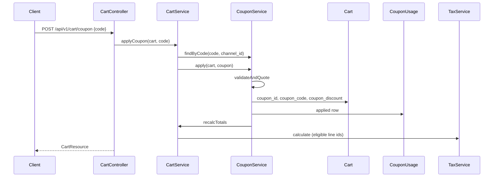

# Workflows — Coupons and Promotions

Module index: [README.md](./README.md)

---

## Admin: create one coupon

```text
GET  /admin/coupons/create
POST /admin/coupons   (creation_mode != bulk)
  → StoreCouponRequest
  → DB::transaction
       Coupon::create(validated + channel_id)
       sync userGroups, products, categories
  → redirect admin.coupons.index
```

---

## Admin: bulk generate coupons

**Inventory:** HTTP generate surface is only `GET /admin/coupons/generate` → redirect `create?mode=bulk`. There is no POST generate route and no separate generate view. `generate()` exists on the controller but is unrouted.

Actual generation:

```text
GET  /admin/coupons/create?mode=bulk   (or generate.form redirect)
POST /admin/coupons  creation_mode=bulk
  → GenerateCouponsRequest
  → generateBulk()
       batch = 'B' + upper(random 6)
       unique codes: prefix + random length from charset
       max attempts = quantity * 20
       per code: Coupon::create(payload + code + batch + channel_id)
                 sync same pivots
  → redirect index?batch={batch}
```

Quantity 1–1000. Collision with existing `coupons.code` skips that attempt. If not enough unique codes: back with error on `quantity`.

---

## Storefront: apply coupon at checkout



On later cart mutations, `CartService::recalcTotals` calls `refreshCouponEffects`: re-quote or `removeCoupon` if validation throws.

Place order (`OrderService`, cart-checkout):

```text
Order.coupon_code / coupon_discount copied from cart
CouponUsage (applied, this cart) → status consumed, order_id set
```

---

## Admin: create/update promotion (campaign)

```text
POST/PUT admin/promotions
  → Store/UpdatePromotionRequest
  → DB::transaction
       Promotion create/update (title, slug, description, status, window, channel_id)
       processMedia (public disk promotions/)
       syncTranslations
       syncItems
         updateOrCreate promotion_items
         applySpecialToProductPrices  (product_prices special_* only)
         product_price_history reason promotion:{id}
         rebuild ProductProjectionService
         StorefrontRevalidator::pingAfterCommit()
```

Item `special_from`/`special_to` default to promotion start/end dates when omitted.

Delete: remove media files, delete promotion (cascade items/translations), rebuild projections for former product IDs, ping revalidator.

---

## Storefront: list promotions

```text
GET /api/v1/promotions?active_only=1
  → Cache 5 min
  → Promotion::forChannel(currentChannel)->active()?->get()
  → PromotionResource
```

CMS home/page widgets (CMS-owned HTTP):

```text
WidgetRenderer::appendPromotions
  → PromotionWidgetResolver::resolveList
       promotions_all | promotions_selected
  → config.promotions = PromotionResource arrays
```

`promotions_selected` only includes **active** promotions in configured ID order. CMS owns widget config (`promotion_ids`, `limit`, `active_only`).

---

## Pricing interaction (this module’s contribution)

1. Catalog / catalog-rules may already set cart item `row_total` (not implemented in this module).
2. Coupon discount is computed on eligible `row_total` sum and stored on `cart.coupon_discount`.
3. `TaxService` allocates that discount only to eligible cart item ids (`discount_eligible`).
4. Promotion specials write to `product_prices` so PLP/PDP/projection see campaign prices even without hitting `/promotions/{id}/products`.

These are sequential checkout/catalog effects, not a single class.
