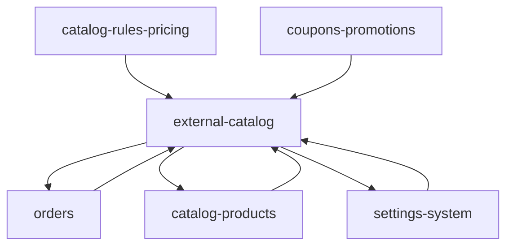

# Dependencies — External catalog

Verified from imports and call sites. Relative links assume sibling folders under `docs/modules/`.

```text
external-catalog
├── depends on
│   ├── orders
│   ├── catalog-products
│   └── settings (SettingService / settings-system)
│
└── consumed by
    ├── orders (observer dispatch + admin sendExternal)
    ├── catalog-products (ISR ping + projection job)
    ├── catalog-rules-pricing (dispatch projection job + ping)
    ├── coupons-promotions (ISR ping after promotion item sync/delete)
    └── settings-system (SystemCacheService revalidate)
```



---

## Depends on: [orders](../orders/README.md)

| Evidence | Path |
|---|---|
| `Order` load + sync columns | `OrderExportService::send` / `buildPayload` |
| `OrderItem` sku/qty/unit_price/`meta.bundle` | `buildTransactionDetails` |
| `OrderAddress` `data` (billing/shipping) | `buildNote` |
| `OrderPayment` `method_code` / `method_name` | `buildPayload` (`payments` or `payment()`) |
| `OrderShipment` `carrier_name` / `service` / `carrier_code` | `buildPayload` |
| Job loads `Order::query()->find` | `SubmitExternalOrderJob` |
| Migration of sync columns | `database/migrations/2026_08_04_124500_add_external_order_sync_to_orders_table.php` |

This module does **not** create orders. Placement is cart-checkout; observer is orders-owned.

---

## Depends on: [catalog-products](../catalog-products/README.md)

| Evidence | Path |
|---|---|
| `Product::isBundle()`, `bundleItems.childProduct` | `OrderExportService::resolveBundleComponents` fallback when `meta.bundle` is absent |
| `ProductProjectionService::rebuildMany` | `RebuildProductProjectionsJob::handle` |
| `config('catalog.default_channel_id')` | `ExternalCatalogOrderSettings::mode` |
| `config('catalog.job_tries' / 'job_timeout' / 'projection_queue')` | `RebuildProductProjectionsJob` constructor |

Projection **domain** (payload, hash, PLP) stays in catalog-products. This module only queues `rebuildMany` for a chunk of ids.

---

## Depends on: settings ([settings-system](../settings-system/))

| Evidence | Path |
|---|---|
| `SettingService::get` | `ExternalCatalogOrderSettings::mode` |
| Schema `product.external_order.mode` | `config/settings.php` |

Admin persist of that key is `SettingController` (`PUT admin.settings.update`) — not owned here.

---

## Consumed by: [orders](../orders/README.md)

- `OrderObserver::created` → `SubmitExternalOrderJob` when auto.
- `OrderController::sendExternal` → `OrderExportService::send` when manual.
- Order show / `_actions` blade for the send button and sync badges.

---

## Consumed by: [catalog-products](../catalog-products/README.md)

- `ProductService::rebuildProjectionsForIds` → `StorefrontRevalidator::pingAfterCommit()`.
- `ProductObserver::deleted` → same after deleting projection rows.
- `products:reindex` dispatches `RebuildProductProjectionsJob` (no ISR ping on that batch).

---

## Consumed by: [catalog-rules-pricing](../catalog-rules-pricing/README.md)

- `CatalogReindexDispatcher::dispatchProjectionRebuilds` dispatches `RebuildProductProjectionsJob` and `StorefrontRevalidator::ping()` on batch `then`.

---

## Consumed by: [coupons-promotions](../coupons-promotions/README.md)

- `PromotionService::rebuildProductProjections` → `StorefrontRevalidator::pingAfterCommit()` after item sync and after promotion delete.

---

## Consumed by: [settings-system](../settings-system/)

- `App\Services\System\SystemCacheService::revalidateStorefront` / `refreshAll` / `status`.
- `App\Http\Controllers\Admin\SystemCacheController` routes `admin.system_cache.revalidate` and `admin.system_cache.refresh_all`.

---

## Related, not a hard module dep

`App\Support\StorefrontUrl` reads `config('external_catalog.revalidate_url')` origin as a **fallback storefront base URL**. It does not ping. Used from auth/mail link building.

---

## Environment names (no values)

From `config/external_catalog.php` and `.env.example`:

| Name | Where |
|---|---|
| `EXTERNAL_CATALOG_BASE_URL` | config |
| `EXTERNAL_CATALOG_SERVICE_PATH` | config |
| `EXTERNAL_CATALOG_API_KEY` | config |
| `EXTERNAL_CATALOG_ORDER_ENDPOINT` | config |
| `EXTERNAL_CATALOG_TIMEOUT` | config |
| `EXTERNAL_CATALOG_ORDER_QUEUE` | config |
| `EXTERNAL_CATALOG_IMPORT_QUEUE` | config fallback for `order_queue` |
| `STOREFRONT_REVALIDATE_URL` | config + `.env.example` |
| `STOREFRONT_REVALIDATE_SECRET` | config + `.env.example` |
| `STOREFRONT_REVALIDATE_TAGS` | config + `.env.example` |
| `STOREFRONT_URL` | `.env.example` + `config/app.php` only — **not** `external_catalog.php` |

Also used by the projection job / dispatchers via `config/catalog.php`: `EXTERNAL_CATALOG_DEFAULT_CHANNEL_ID`, `EXTERNAL_CATALOG_PROJECTION_QUEUE`, `EXTERNAL_CATALOG_PROJECTION_CHUNK`.

`.env.example` does not list `EXTERNAL_CATALOG_*`.

---

## Not found

- Elkos catalog **import** service/job/command under `App\Services\ExternalCatalog` or `App\Jobs\ExternalCatalog`
- Inbound webhooks for Elkos or `/api/revalidate`
- HTTP `retry()` on either client
- Feature tests for send-external, the job, or `StorefrontRevalidator`
- Controllers, routes, or models owned by this module
