# Workflows — External catalog

Mermaid below follows current PHP, not an intended future design.

---

## 1. Order export (Elkos)

Mode: `ExternalCatalogOrderSettings` → setting `product.external_order.mode` (`auto` \| `manual`, default `manual`) for `config('catalog.default_channel_id', 1)` when callers omit channel id.

```mermaid
sequenceDiagram
    participant Place as Order create (checkout / specialist)
    participant Obs as OrderObserver.created
    participant Job as SubmitExternalOrderJob
    participant Set as ExternalCatalogOrderSettings
    participant Admin as OrderController.sendExternal
    participant Exp as OrderExportService
    participant Api as ExternalCatalogApiService
    participant Elkos as Elkos Order HTTP

    Place->>Obs: Order saved (created)
    Obs->>Obs: DB afterCommit
    Obs->>Set: isAuto()
    alt auto
        Obs->>Job: dispatch(orderId) queue imports
        Job->>Set: isAuto()
        alt still auto and order exists and status not synced
            Job->>Exp: send(order)
        else skip
            Job-->>Job: return
        end
    else manual
        Note over Obs: no job
    end

    Admin->>Set: isManual()
    alt not manual
        Admin-->>Admin: ValidationException external_order
    else manual and order_edit
        Admin->>Exp: send(order)
        alt success
            Admin-->>Admin: flash success
        else failure
            Admin-->>Admin: flash error
        end
    end

    Exp->>Exp: status pending, clear error
    Exp->>Exp: buildPayload Transaction
    Exp->>Api: submitOrder(payload)
    Api->>Elkos: POST JSON timeout config X-API-KEY if set
    alt JSON array and HTTP success
        Exp->>Exp: status synced, synced_at, sync_response
    else Throwable
        Exp->>Exp: status failed, sync_error
        Exp->>Exp: Log.error External order export failed
    end
```

Admin HTTP (owned by [orders](../orders/README.md)):

| | |
|---|---|
| Route | `POST /admin/orders/{order}/send-external` |
| Name | `admin.orders.send.external` |
| Controller | `App\Http\Controllers\Admin\OrderController::sendExternal` |
| Permission | `order_edit` (`check.permission:order_edit`) |
| Guard | `ExternalCatalogOrderSettings::isManual()` or `ValidationException` key `external_order` |

UI: `resources/views/admin/orders/_actions.blade.php` and header on `show.blade.php` — button only when `$externalOrderManual`. Labels say CFMA; exporter/logs say Elkos. `show()` sets `$externalOrderManual = app(ExternalCatalogOrderSettings::class)->isManual()`.

Payload line expansion (bundles) is the only path covered by tests; see [tests.md](tests.md).

---

## 2. Storefront ISR revalidate

```mermaid
flowchart TD
    subgraph callers [Callers]
      P[ProductService.rebuildProjectionsForIds]
      D[ProductObserver.deleted]
      R[PromotionService.rebuildProductProjections]
      C[CatalogReindexDispatcher batch then]
      S[SystemCacheService.revalidateStorefront]
      V["artisan storefront:verify-revalidate --ping"]
    end

    P --> PAC[StorefrontRevalidator.pingAfterCommit]
    D --> PAC
    R --> PAC
    PAC --> MERGE[Merge unique tags into pendingTags]
    MERGE --> TX{DB transactionLevel gt 0?}
    TX -->|yes| AC[DB.afterCommit flush]
    TX -->|no| FLUSH[flush now]
    AC --> PING[ping]
    FLUSH --> PING
    AC2[DB.afterRollback] --> CLR[Clear pendingTags and flushRegistered]

    C --> PING2[StorefrontRevalidator.ping]
    PING2 --> ATT
    PING --> ATT[attempt]
    S --> ATT
    V --> HTTP

    ATT --> CHK{URL and secret set?}
    CHK -->|no| SKIP[skipped true never throw]
    CHK -->|yes| TAGS{tags nonempty?}
    TAGS -->|no| SKIP
    TAGS -->|yes| HTTP["POST url JSON tags header x-revalidate-secret timeout 15"]
    HTTP --> OK{successful?}
    OK -->|yes| INFO[ping: logger info]
    OK -->|401 or 403| FAIL[secret mismatch message]
    OK -->|503| FAIL2[storefront secret not loaded]
    OK -->|other or throw| FAIL3[failed message]
```

Default tags when callers pass `null`: `config('external_catalog.revalidate_tags')`, fallback in code `['catalog']`.

Admin cache UI (owned by [settings-system](../settings-system/)):

| Route | Name | Controller | Permission | Service |
|---|---|---|---|---|
| `GET /admin/system-cache` | `admin.system_cache.index` | `SystemCacheController::index` | `system_cache_view` | `status()` reads revalidate URL/tags/enabled |
| `POST /admin/system-cache/revalidate` | `admin.system_cache.revalidate` | `revalidate` | `system_cache_edit` | `revalidateStorefront()` → `StorefrontRevalidator::attempt()` |
| `POST /admin/system-cache/refresh-all` | `admin.system_cache.refresh_all` | `refreshAll` | `system_cache_edit` | clear → optimize → `revalidateStorefront()` |

`SystemCacheService::status()` sets `revalidate_enabled` when both URL and secret are non-empty. It does **not** display the secret.

`CatalogReindexDispatcher` uses `ping()` (immediate, no `afterCommit` coalesce). Product/promotion admin paths use `pingAfterCommit()`.

`products:reindex` batches named `products:reindex` do **not** ping. Only `catalog:projections` batches ping on `then`.
