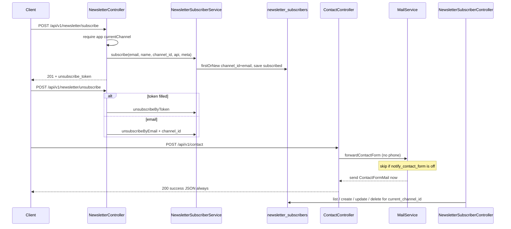

# Newsletter and contact

Storefront **newsletter subscribe / unsubscribe** and **contact-form forwarding**, plus admin CRUD for newsletter subscribers.

This module is not a Composer package. Types live under `App\` and share `routes/api.php` / `routes/web.php` with the rest of the app.

## Purpose

- Persist per-channel subscribers on `newsletter_subscribers` (`subscribed` / `unsubscribed`).
- Public API: `POST /api/v1/newsletter/subscribe` and `POST /api/v1/newsletter/unsubscribe`.
- Public API: `POST /api/v1/contact` — validate the form and ask [shared mail](../../shared/README.md#mail) to send `ContactFormMail` to the admin inbox.
- Admin list (Yajra DataTables), create, edit, and hard-delete subscribers for the signed-in user’s `current_channel_id`.

This module does **not** send a welcome or unsubscribe email to the subscriber. It does **not** persist contact-form rows. CMS `contact_form` widgets are owned by [cms-pages-widgets](../cms-pages-widgets/README.md); they only point the storefront at this contact endpoint.

## Owned vs not owned

| Owned here | Owned elsewhere |
| --- | --- |
| `App\Models\NewsletterSubscriber` | `App\Models\Channel` — [channels-locales](../channels-locales/README.md) |
| `App\Services\NewsletterSubscriberService` | `App\Services\Mail\MailService` — [shared mail](../../shared/README.md#mail) |
| `App\Http\Controllers\Api\V1\NewsletterController` | `setting()` / `SettingService` / `config/settings.php` — [settings-system](../settings-system/README.md) |
| `App\Http\Controllers\Api\V1\ContactController` | `App\Services\Cms\WidgetRenderer::appendContactForm` — [cms-pages-widgets](../cms-pages-widgets/README.md) |
| `App\Http\Controllers\Admin\NewsletterSubscriberController` | `newsletter_*` permissions seeder rows — [users-access-control](../users-access-control/README.md) |
| API + admin FormRequests listed below | `MailService::forwardContactForm` dispatch plumbing |
| `App\Mail\Admin\ContactFormMail` | `php artisan mail:test` — `App\Console\Commands\TestMailCommand` (shared) |
| Migration `newsletter_subscribers` | Footer “contact lines”, GDPR `gdpr.newsletter_consent_text`, theme `crm-contacts.js` |

## Source code locations

```text
app/Models/NewsletterSubscriber.php
app/Services/NewsletterSubscriberService.php
app/Http/Controllers/Api/V1/NewsletterController.php
app/Http/Controllers/Api/V1/ContactController.php
app/Http/Controllers/Admin/NewsletterSubscriberController.php
app/Http/Requests/Api/V1/SubscribeNewsletterRequest.php
app/Http/Requests/Api/V1/UnsubscribeNewsletterRequest.php
app/Http/Requests/Api/V1/ContactFormRequest.php
app/Http/Requests/Admin/NewsletterSubscriber/StoreNewsletterSubscriberRequest.php
app/Http/Requests/Admin/NewsletterSubscriber/UpdateNewsletterSubscriberRequest.php
app/Mail/Admin/ContactFormMail.php
database/migrations/2026_04_09_120000_create_newsletter_subscribers_table.php
routes/api.php                                 # newsletter/*, contact
routes/web.php                                 # admin.newsletters.*
database/seeders/ModulePermissionSeeder.php    # module "Newsletters"
resources/views/admin/newsletters/index.blade.php
resources/views/admin/newsletters/create.blade.php
resources/views/admin/newsletters/edit.blade.php
resources/views/admin/newsletters/_form.blade.php
resources/views/admin/newsletters/actions.blade.php
resources/views/emails/admin/contact-form.blade.php
lang/en/translations.php                       # translations.admin.newsletters.*, sidebar.newsletters
lang/sq/translations.php                       # same keys
```

Related code owned by other modules (wiring / consumers only):

```text
app/Services/Mail/MailService.php              # forwardContactForm()
app/Console/Commands/TestMailCommand.php       # mail:test admin-contact
app/Services/Cms/WidgetRenderer.php            # submit_endpoint = url('/api/v1/contact')
app/Http/Controllers/Admin/WidgetController.php
app/Http/Middleware/ResolveApiChannel.php      # alias channel.api
app/helpers.php                                # setting()
config/settings.php                            # notifications.admin.notify_contact_form, mail from/to keys
resources/views/layouts/components/main-sidebar.blade.php
postman_collection.json                        # folder "Newsletter and Contact"
```

Not this module: `resources/assets/js/crm-contacts.js` is theme CRM demo JS. Footer contact lines (`FooterSections`, `admin/settings/_footer_contact_line_row.blade.php`) are settings/footer UI, not `ContactController`.

## Main components

| Type | Class | Responsibility |
| ---- | ----- | -------------- |
| Model | `App\Models\NewsletterSubscriber` | Eloquent row for `newsletter_subscribers` |
| Service | `App\Services\NewsletterSubscriberService` | Subscribe upsert, unsubscribe by email or token |
| Controller | `App\Http\Controllers\Api\V1\NewsletterController` | Public subscribe / unsubscribe JSON |
| Controller | `App\Http\Controllers\Api\V1\ContactController` | Public contact JSON |
| Controller | `App\Http\Controllers\Admin\NewsletterSubscriberController` | Admin list / create / edit / delete |
| FormRequest | `App\Http\Requests\Api\V1\SubscribeNewsletterRequest` | Subscribe body |
| FormRequest | `App\Http\Requests\Api\V1\UnsubscribeNewsletterRequest` | Unsubscribe body (`email` xor `token`) |
| FormRequest | `App\Http\Requests\Api\V1\ContactFormRequest` | Contact body |
| FormRequest | `App\Http\Requests\Admin\NewsletterSubscriber\StoreNewsletterSubscriberRequest` | Admin create |
| FormRequest | `App\Http\Requests\Admin\NewsletterSubscriber\UpdateNewsletterSubscriberRequest` | Admin update (extends store) |
| Mailable | `App\Mail\Admin\ContactFormMail` | Admin “new contact” email |

No newsletter/contact factories, API resources, policies, observers, jobs, events, or listeners exist in this repository.

## Module dependencies

Verified from code (details in [dependencies.md](dependencies.md)):

```text
This module depends on:
- channels-locales   (Channel FK, app('currentChannel'), admin current_channel_id)
- [mail](../../shared/README.md#mail) (MailService::forwardContactForm, ContactFormMail send path)
- settings-system    (setting() keys on ContactFormMail / MailService)
- users-access-control  (newsletter_* permissions, check.permission, role:Admin)

This module is used by:
- cms-pages-widgets  (contact_form widget submit_endpoint → POST /api/v1/contact)
```

## Entry points

| Kind | Entry |
| ---- | ----- |
| API | `POST /api/v1/newsletter/subscribe` |
| API | `POST /api/v1/newsletter/unsubscribe` |
| API | `POST /api/v1/contact` (middleware `throttle:10,1`) |
| Web (admin) | `GET/POST/PUT/DELETE` under `/admin/newsletters*` (named `admin.newsletters.*`) |
| Artisan (shared mail tester) | `php artisan mail:test admin-contact` — sends `ContactFormMail` with a hard-coded sample; does not call `MailService` |
| Queue | `ContactFormMail` implements `ShouldQueueAfterCommit`, but `MailService::forwardContactForm` uses `Mail::to()->send()` (synchronous). See [notifications.md](notifications.md) |
| Events / scheduler | None for this module |

## Important business rules

Extracted from code only:

- Newsletter identity is **`(channel_id, email)`** (unique index). Email is normalized with `Str::lower(trim(...))` in the service and in subscribe/unsubscribe/admin FormRequests.
- API subscribe is an **upsert** (`firstOrNew`). Re-subscribe sets `status = subscribed`, `subscribed_at = now()`, `unsubscribed_at = null`, merges `meta`, and keeps an existing `unsubscribe_token`.
- Admin create uses `Rule::unique` on `(channel_id, email)` and therefore **rejects** an email that already exists on that channel (HTTP 422). It does not upsert.
- Admin create always calls `subscribe(..., source: 'admin')` first. If the form status is `unsubscribed`, it then `update`s `status` and `unsubscribed_at = now()`. `subscribed_at` from `subscribe()` remains set.
- Admin **update** does not use `NewsletterSubscriberService`. It writes `name`, `email`, `status`, optional `source` fallback `'admin'`, minting `unsubscribe_token` if missing.
- API unsubscribe: if `token` is filled, `unsubscribeByToken` runs (**not** filtered by current channel). Otherwise `unsubscribeByEmail` uses the resolved channel. Missing row → HTTP 404 `{ "success": false, "message": "Subscriber not found." }`.
- Both newsletter API methods return HTTP **400** `{ "success": false, "message": "Channel not resolved" }` when `app('currentChannel')` is falsy — including unsubscribe-by-token.
- `ResolveApiChannel` binds `currentChannel` (query `channel`, header `X-Channel`, authenticated `currentChannel`, else `Channel` with `code = default`). That value may still be `null` if none of those match.
- Status strings used in PHP: `subscribed`, `unsubscribed`. The database column is `string(32)` with default `subscribed`; it is not a native enum.
- Source strings written by this module: `'api'` (API subscribe), `'admin'` (admin create; admin update if `source` was empty). No other writers were found.
- API subscribe stores `meta.ip` and `meta.user_agent`. Admin create does not pass `meta`.
- Contact `phone` is validated and then **discarded**. `ContactController` does not pass it to `MailService` or `ContactFormMail`. The email view has no phone field.
- `ContactController::send` always returns HTTP 200 `{ "success": true, "message": "Your message has been sent. We will get back to you shortly." }` after calling `forwardContactForm`. If `notifications.admin.notify_contact_form` is off, or `Mail::send` throws (caught and logged in `MailService::sendNow`), the JSON is still that success payload. No contact row is stored.
- Admin list/edit/delete query `NewsletterSubscriber::forChannel($this->channelId())` where `channelId()` is `(int) auth()->user()->current_channel_id`.
- Deletes are hard deletes (`NewsletterSubscriber` does not use `SoftDeletes`). Channel delete cascade-deletes subscribers (`cascadeOnDelete` on `channel_id`).
- `gdpr.newsletter_consent_text` exists in `config/settings.php` and is **not** read by any class in this module.



## Configuration

There is no `config/newsletter.php`. Runtime toggles used here are settings keys (see [notifications.md](notifications.md) and [dependencies.md](dependencies.md)):

| Setting key | Schema default (`config/settings.php`) | Used by |
| --- | --- | --- |
| `notifications.admin.notify_contact_form` | `true` (`public` false) | `MailService::forwardContactForm` |
| `notifications.admin.email` | none in schema (`required` true) | `MailService::adminEmail`, `ContactFormMail::envelope` `to` |
| `notifications.mail.from_address` | none in schema (`required` true) | `ContactFormMail` From, fallback `config('mail.from.address')` |
| `notifications.mail.from_name` | `'Commerce'` | `ContactFormMail` From name, fallback `config('mail.from.name')` |

`config/mail.php` `from.address` / `from.name` read env **names** `MAIL_FROM_ADDRESS` and `MAIL_FROM_NAME` (framework defaults in that file: `hello@example.com` / `Example`). Do not copy live SMTP credentials.

API group middleware: `channel.api`, `locale.api`. Newsletter and contact handlers do not read locale.

## Docs in this folder

| File | Contents |
| --- | --- |
| [models.md](models.md) | `NewsletterSubscriber` |
| [database.md](database.md) | `newsletter_subscribers` |
| [controllers.md](controllers.md) | API + admin controllers |
| [services.md](services.md) | `NewsletterSubscriberService`; `MailService` call site |
| [requests-validation.md](requests-validation.md) | FormRequests |
| [routes.md](routes.md) | API and `admin.newsletters.*` |
| [api.md](api.md) | Storefront JSON contracts |
| [notifications.md](notifications.md) | `ContactFormMail` (not Laravel Notifications) |
| [dependencies.md](dependencies.md) | Verified module deps |
| [tests.md](tests.md) | No in-repo tests |
