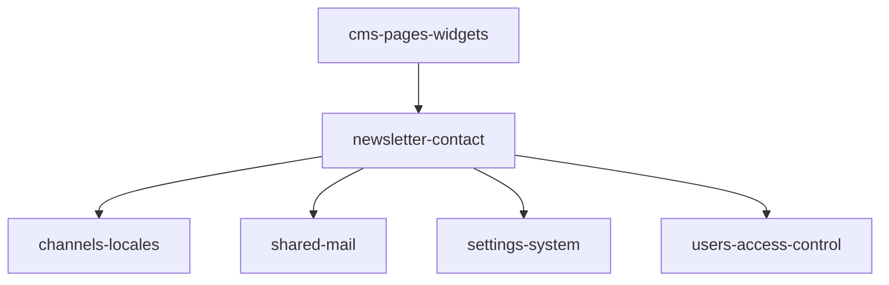

# Newsletter and contact — Dependencies

Module README: [README.md](README.md)

Verified from imports and call sites. Sibling module folders are named to match this documentation set; they are not re-documented here.

```text
newsletter-contact
├── depends on
│   ├── channels-locales
│   ├── mail (docs/shared, not a module folder)
│   ├── settings-system
│   └── users-access-control
│
└── consumed by
    └── cms-pages-widgets     (contact_form submit_endpoint)
```



Coordinator named deps: **mail** ([shared](../../shared/README.md#mail)), **settings-system**. The extra edges below are also in the code.

---

## Depends on: [channels-locales](../channels-locales/README.md)

**Verified.**

| Reference | Where |
| --------- | ----- |
| `App\Models\Channel` | `NewsletterSubscriber::channel()`; `NewsletterSubscriberService::resolveChannelId` fallback `Channel::query()->orderBy('id')->value('id')` |
| `app('currentChannel')` | API subscribe/unsubscribe; service fallback |
| `ResolveApiChannel` (`channel.api`) | API group in `routes/api.php` |
| `users.current_channel_id` / `User::currentChannel()` | Admin `channelId()`, unique validation, index Blade channel name |
| `SetCurrentChannel` | Appended to `web` (`bootstrap/app.php`) |

This module does not create channels. API channel codes are `channels.code` (`?channel=` / `X-Channel`), not numeric ids.

`locale.api` is on the same route group; newsletter/contact PHP does not read locale.

---

## Depends on: [mail](../../shared/README.md#mail)

**Verified.**

| Reference | Where |
| --------- | ----- |
| `App\Services\Mail\MailService` | `ContactController::send` → `forwardContactForm` |
| `App\Mail\Admin\ContactFormMail` | Instantiated in `MailService` and `TestMailCommand::makeAdminContact` |
| `Illuminate\Support\Facades\Mail` | Inside `MailService::sendNow` (and the shared `mail:test` command) |

`MailService` is a shared class; only `forwardContactForm` / `sendAdminNow` / `adminEmail` are on this module’s contact path. Newsletter code does not import it.

---

## Depends on: [settings-system](../settings-system/README.md)

**Verified.**

Keys read on the contact path (via `setting()` in `app/helpers.php` → `SettingService::get`):

| Key | Reader |
| --- | ------ |
| `notifications.admin.notify_contact_form` | `MailService::forwardContactForm` |
| `notifications.admin.email` | `MailService::adminEmail`; `ContactFormMail::envelope` `to` |
| `notifications.mail.from_address` | `ContactFormMail` From |
| `notifications.mail.from_name` | `ContactFormMail` From name |

Schema: `config/settings.php` group `notifications`. SMTP host/username/password fields exist in that schema for the mail driver UI; this module’s PHP does not read those keys directly (the mailer uses Laravel `config/mail.php` / runtime mail config owned by mail/settings). **Do not commit secret values.**

`gdpr.newsletter_consent_text` is defined in the same settings file (GDPR group, `public` true, textarea). **No PHP in `app/` references that key.** Storefront consent APIs are not part of this module.

---

## Depends on: [users-access-control](../users-access-control/README.md)

**Verified** for admin only.

| Reference | Where |
| --------- | ----- |
| Module `Newsletters` + `newsletter_view/create/edit/delete` | `ModulePermissionSeeder` |
| `check.permission:newsletter_*` | `NewsletterSubscriberController` constructor |
| `role:Admin` | Admin route group |
| `auth`, `verified.if-required` | Same group |
| Blade `@can` / `@canany` | Sidebar, index create button, actions dropdown |
| `Gate::before` Super Admin / access-level | `AuthServiceProvider` (Blade `@can`); HTTP middleware is `AutoAuthorizePermission` only |

API routes have no permission names.

---

## Consumed by: [cms-pages-widgets](../cms-pages-widgets/README.md)

**Verified.**

`WidgetRenderer::appendContactForm`: if `$widget->type === 'contact_form'`, sets `$config['submit_endpoint'] = url('/api/v1/contact')`.

Admin widget type `contact_form` and `WidgetController::contactFormTranslationFields()` configure labels / `show_phone` / `show_subject`. That UI does not call `ContactController`; the storefront is expected to POST to the API. `show_phone` does not change `ContactFormRequest` (phone stays optional) and does not cause phone to be mailed.

---

## Packages used here

From `composer.json` `require` (this app), as used by this module’s code:

| Package | Constraint | Role |
| ------- | ---------- | ---- |
| `php` | `^8.2` | Runtime |
| `laravel/framework` | `^12.0` | HTTP, validation, mail, Eloquent |
| `yajra/laravel-datatables-oracle` | `^12.4` | Admin `index` AJAX |

Spatie permission / access-level checks are via User + seeder, not a direct import in newsletter classes.

---

## Explicitly not found

- Newsletter or contact factories, policies, observers, jobs, events, listeners, API resources.
- A `config/newsletter.php` file.
- Callers of `NewsletterSubscriberService` other than the two controllers above.
- Persistence of contact submissions.
- Use of `gdpr.newsletter_consent_text` by newsletter/contact classes.
- Tests under `tests/` ([tests.md](tests.md)).
