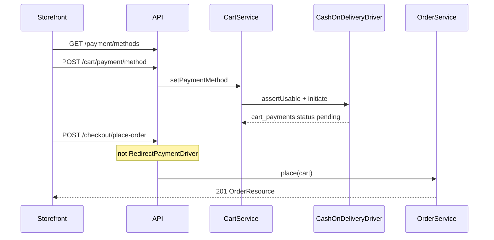

# Payments workflows

Source of truth for the storefront after redirect is `GET /api/v1/payments/{gateway}/status?gateway_order_id=`, not URL query flags.

## COD (no capture / notify)



## RaiAccept: initiate, return/notify, finalize

```mermaid
sequenceDiagram
    participant SF as Storefront
    participant API as Checkout / callbacks
    participant Drv as RaiAcceptDriver
    participant Bank as RaiAccept / UPC
    participant Cb as RaiAcceptCallbackHandler
    participant Job as FinalizeRaiAcceptOrderJob
    participant OS as OrderService

    SF->>API: POST /cart/payment/method
    API->>Drv: initiate (sign SHA-512, store OrderID)
    SF->>API: POST /checkout/place-order
    Drv-->>SF: 202 gateway_url + form payload
    SF->>Bank: POST form to gateway_url
    Bank-->>Cb: browser GET/POST /payments/raiaccept/return
    Bank-->>Cb: server /payments/raiaccept/notify
    Note over Cb: verify Signature; TranCode padded to 000
    alt cart already authorized/failed/cancelled
        Cb-->>SF: redirect result_url (return) or notify text
    else first terminal callback
        Cb->>Job: dispatchSync
        alt TranCode is exactly 000
            Job->>OS: place idempotency raiaccept:OrderID
            Job->>Job: order processing + optional send_invoice mail
        else not 000
            Job->>Job: OrderPayment failed if order exists
        end
    end
    SF->>API: GET /payments/raiaccept/status?gateway_order_id=
    API-->>SF: cart_payments.status + cart.order_id
```

Optional: storefront POSTs bank query fields to `/payments/raiaccept/capture-browser-result` instead of hitting `/return` (JSON, no bounce).

`capture_browser_return` false: bank SUCCESS/FAILURE URLs go straight to storefront `success_url` / `failure_url`; notify `forwardUrl` uses those when set.

## PCB Bank: create order, HPP, return/notify, finalize

```mermaid
sequenceDiagram
    participant SF as Storefront
    participant API as Checkout / callbacks
    participant Drv as PcbBankDriver
    participant TXPG as TXPG REST mTLS
    participant HPP as Hosted payment page
    participant Cb as PcbBankCallbackHandler
    participant Job as FinalizePcbBankOrderJob
    participant OS as OrderService

    SF->>API: POST /cart/payment/method
    API->>Drv: initiate
    Drv->>TXPG: POST /order (Browser, paymentMethods any)
    TXPG-->>Drv: id, password, hppUrl, status
    SF->>API: POST /checkout/place-order
    alt cart payment still pending
        Drv-->>SF: 202 redirect_url ?id&password
    else refused/failed/cancelled session
        Drv->>TXPG: POST /order again
        Drv-->>SF: 202 new HPP
    end
    SF->>HPP: GET hppUrl/?id=&password=
    HPP-->>API: GET/POST /payments/pcbbank/return ID STATUS
    Note over Cb: GET /order/{id}?password&tokenDetailLevel=2&tranDetailLevel=1
    Cb->>TXPG: getOrder (source of truth)
    Cb->>Job: dispatchSync
    alt PcbBankStatus success
        Job->>OS: place idempotency pcbbank:id
        Job->>Job: order processing + optional send_invoice mail
    else failure statuses
        Job->>Job: OrderPayment failed if order exists
    else Preparing / WaitPushTran / other
        Job->>Job: isSuccess false; no place
    end
    SF->>API: GET /payments/pcbbank/status?gateway_order_id=
```

Vendor WooCommerce plugin (`txpg_webhook`) also reads GET `ID` + `STATUS` then GETs the order over client certificates. This app does the same lookup; it does not implement TXPG `exec-tran` refunds (plugin has that path; this codebase does not call it).
