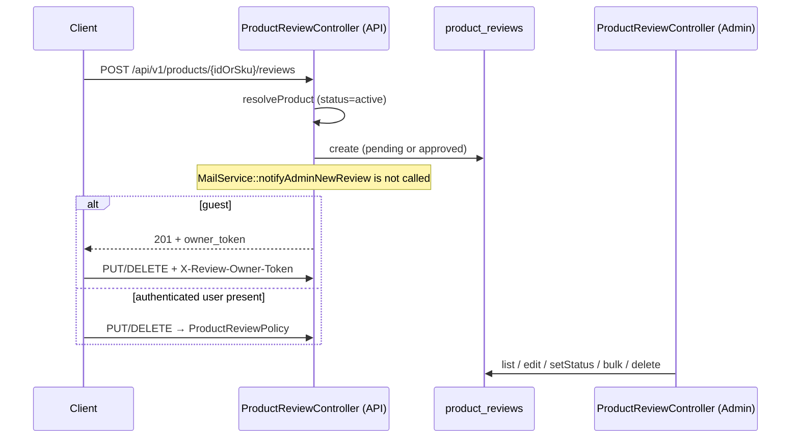

# Reviews

## Purpose

Storefront product-review create / update / delete, plus admin moderation of `product_reviews`. Catalog product APIs expose **rating aggregates** from approved reviews; they do **not** return a live review list.

## Responsibilities

- Persist reviews against an **active** product (resolved by numeric id, SKU, or translation slug).
- Allow guests when `config('reviews.guests_enabled')` is true; mint a time-limited owner edit token for guests.
- Optionally enforce one review per product per user/email (`reviews.single_per_product`).
- Set create status from `reviews.auto_approve` (`approved` vs `pending`).
- Authorize logged-in API updates/deletes via `ProductReviewPolicy`; guests via `X-Review-Owner-Token` or `owner_token`.
- Admin DataTables listing, edit, status, bulk approve/reject/spam/delete, and single delete.
- Seed Spatie/access-level permissions `review_view`, `review_edit`, `review_delete`.

This module does **not** own catalog projection, user accounts, or SMTP settings. Those are consumed as dependencies.

## Source Code Locations

```text
app/Models/ProductReview.php
app/Policies/ProductReviewPolicy.php
app/Providers/AuthServiceProvider.php          # ProductReview => ProductReviewPolicy
app/Http/Controllers/Api/V1/ProductReviewController.php
app/Http/Controllers/Admin/ProductReviewController.php
app/Http/Requests/Api/V1/StoreProductReviewRequest.php
app/Http/Requests/Api/V1/UpdateProductReviewRequest.php
app/Http/Requests/Admin/ProductReview/UpdateProductReviewRequest.php
app/Mail/Admin/NewReviewMail.php
config/reviews.php
routes/api.php                                 # products/{idOrSku}/reviews, reviews/{id}
routes/web.php                                 # admin.reviews.*
database/migrations/2025_08_25_153836_create_products_table.php   # Schema::create('product_reviews')
database/migrations/2025_08_30_155802_add_owner_token_to_product_reviews.php.php
database/seeders/ModulePermissionSeeder.php    # module "Reviews"
resources/views/admin/reviews/index.blade.php
resources/views/admin/reviews/edit.blade.php
resources/views/admin/reviews/actions.blade.php
resources/views/emails/admin/new-review.blade.php
lang/en/translations.php                       # translations.admin.reviews.*
lang/sq/translations.php
```

Related code owned by other modules (consumers / wiring only):

```text
app/Models/Product.php                         # reviews() HasMany — catalog-products
app/Services/Product/ProductProjectionService.php   # withAvg / withCount approved reviews
app/Services/Product/Api/ProductPayloadBuilder.php  # rating.avg / rating.count
app/Http/Resources/Api/V1/ProductProjectionDetailResource.php  # 'reviews' => null
app/Services/Mail/MailService.php              # notifyAdminNewReview() — not called from review store
app/Console/Commands/TestMailCommand.php       # mail:test admin-new-review
```

Not this module: `resources/assets/js/reviews.js` is theme testimonial Swiper code, not `ProductReview`.

## Main Components

| Type | Class | Responsibility |
| ---- | ----- | -------------- |
| Model | `App\Models\ProductReview` | Eloquent row for `product_reviews` |
| Policy | `App\Policies\ProductReviewPolicy` | API `update` / `delete` for authenticated users |
| Controller | `App\Http\Controllers\Api\V1\ProductReviewController` | Storefront create / update / destroy |
| Controller | `App\Http\Controllers\Admin\ProductReviewController` | Admin list / edit / status / bulk / delete |
| FormRequest | `App\Http\Requests\Api\V1\StoreProductReviewRequest` | Create body + guest identity |
| FormRequest | `App\Http\Requests\Api\V1\UpdateProductReviewRequest` | API patch/put fields |
| FormRequest | `App\Http\Requests\Admin\ProductReview\UpdateProductReviewRequest` | Admin edit form |
| Mailable | `App\Mail\Admin\NewReviewMail` | Queued admin “new review” email |
| Config | `config/reviews.php` | Guest, auto-approve, rating range, uniqueness, guest token TTL |

No review-specific services, repositories, actions, jobs, events, listeners, API resources, or factories exist in this repository.

## Module Dependencies

Verified from code references (details in [dependencies.md](dependencies.md)):

```text
This module depends on:
- catalog-products  (Product, translations, status=active, Product::reviews())
- auth              (User, session Admin, optional $request->user(), Sanctum tokens on User)

Also referenced (not owned here):
- users-access-control  (review_* permissions, check.permission, role:Admin, Gate::before)
- channels-locales      (API group middleware locale.api, channel.api)
- settings              (setting() keys used by NewReviewMail / MailService)

This module is used by:
- catalog-products  (approved review avg/count on projection payload)
```

## Entry Points

| Kind | Entry |
| ---- | ----- |
| API | `POST /api/v1/products/{idOrSku}/reviews` |
| API | `PUT` / `PATCH` `/api/v1/reviews/{id}` |
| API | `DELETE /api/v1/reviews/{id}` |
| Web (admin) | `GET/PUT/POST/DELETE` under `/admin/reviews*` (named `admin.reviews.*`) |
| Artisan (shared mail tester) | `php artisan mail:test admin-new-review` — sends `NewReviewMail` with a hard-coded sample payload; not invoked by review create |
| Queue | `NewReviewMail` implements `ShouldQueueAfterCommit`; only queued if `MailService::notifyAdminNewReview()` or `Mail::queue`/`Mail::to()->send` is used |
| Events / scheduler | None for this module |

## Important Business Rules

Extracted from code only:

- Create is allowed for a logged-in user, **or** for a guest when `reviews.guests_enabled` is true (`StoreProductReviewRequest::authorize()`). Config default is `true`.
- Product must exist with `products.status = 'active'`. Lookup: numeric `idOrSku` → `products.id`; otherwise SKU, then translation slug for current locale, then any-locale slug. Inactive products 404.
- If `reviews.single_per_product` is true (config default `false`): authenticated uniqueness is `(product_id, user_id)`; guest uniqueness is `(product_id, author_email)`. Duplicate returns HTTP 422 `{ "message": "You already reviewed this product." }`.
- Create status is `approved` if `reviews.auto_approve` else `pending`. Config default `auto_approve` is `false`.
- Guests receive `owner_edit_token` (UUID string) and `owner_token_expires_at` = now + `reviews.guest_token_ttl_days` (default 14). Authenticated creates do not set those columns; API response `owner_token` / `token_expires_at` are `null`.
- Guest update/delete: token from header `X-Review-Owner-Token` or query `owner_token`, compared with `hash_equals`, rejected if missing/mismatch or if `owner_token_expires_at` is set and in the past → 403 `{ "message": "Forbidden" }`. Null `owner_token_expires_at` skips the expiry check.
- If `$req->user()` is present on update/delete, the guest-token branch is **not** used; `authorize('update'|'delete', $review)` runs instead.
- Policy: owner (`user_id` match) **or** `$user->can('review_edit')` / `review_delete`.
- API `status` on update is applied only when `$req->user()?->can('review_edit')` and `status` is filled. FormRequest allows `pending|approved|rejected` (not `spam`).
- Admin statuses include `spam` in addition to pending/approved/rejected.
- Admin and API `delete()` are hard deletes (`ProductReview` does not use `SoftDeletes`). Product FK is `cascadeOnDelete`; user FK is `nullOnDelete`.
- `ProductReviewController::store()` does **not** call `MailService::notifyAdminNewReview()`. A comment in `store()` notes an optional notification/event. The mailable and `MailService` method exist but are unwired from review create.
- Product detail API sets `'reviews' => null` in `ProductProjectionDetailResource`. There is no GET reviews list endpoint.
- Projection rating uses only reviews with `status = 'approved'`.



## Configuration

Source: `config/reviews.php`. This file does **not** call `env()`. There are no `REVIEWS_*` keys in `.env.example`.

| Key | Config default | Used by |
| --- | -------------- | ------- |
| `guests_enabled` | `true` | `StoreProductReviewRequest::authorize()` |
| `auto_approve` | `false` | API `store()` status |
| `rating.min` / `rating.max` | `1` / `5` | API FormRequests |
| `single_per_product` | `false` | API `store()` uniqueness |
| `guest_token_ttl_days` | `14` | API `store()` guest token expiry |

Admin rating validation is hard-coded `min:1` / `max:5`, not `config('reviews.rating')`.

## Docs in this folder

- [models.md](models.md)
- [database.md](database.md)
- [controllers.md](controllers.md)
- [requests-validation.md](requests-validation.md)
- [routes.md](routes.md)
- [api.md](api.md)
- [permissions.md](permissions.md)
- [notifications.md](notifications.md)
- [dependencies.md](dependencies.md)
- [tests.md](tests.md)
