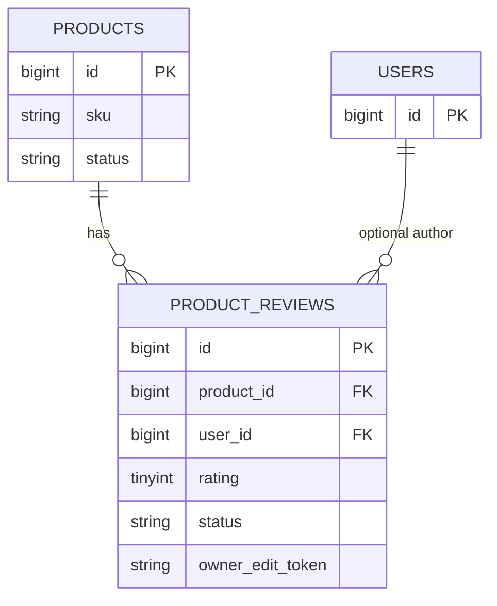

# Reviews — Database

Module README: [README.md](README.md)

## Table: `product_reviews`

### Purpose

Stores storefront and guest product reviews and admin moderation state.

### Created By

1. `database/migrations/2025_08_25_153836_create_products_table.php` — `Schema::create('product_reviews', ...)` inside the products migration (same file also creates `products` and related catalog tables).
2. `database/migrations/2025_08_30_155802_add_owner_token_to_product_reviews.php.php` — adds guest owner-token and `edited_at` columns. Filename on disk has a duplicated `.php` extension.

There is no dedicated `product_reviews` factory or seeder.

### Columns

Types and nullability are from migrations, not inferred from the model.

| Column | Type | Nullable | Default | Description |
| ------ | ---- | -------- | ------- | ----------- |
| `id` | bigIncrements | no | | Primary key |
| `product_id` | unsignedBigInteger | no | | Product FK |
| `user_id` | unsignedBigInteger | yes | `null` | User FK |
| `author_name` | string | yes | `null` | Author display name |
| `author_email` | string | yes | `null` | Author email |
| `rating` | tinyInteger | no | | Comment in migration: `1..5` |
| `title` | string | yes | `null` | Optional title |
| `comment` | text | yes | `null` | Body |
| `status` | string(20) | no | `pending` | Migration comment: `pending\|approved\|rejected`. Admin also writes `spam`. |
| `ip` | string(45) | yes | `null` | Client IP |
| `user_agent` | string(512) | yes | `null` | User-Agent |
| `owner_edit_token` | string(64) | yes | `null` | Added in owner-token migration |
| `owner_token_expires_at` | timestamp | yes | `null` | Added in owner-token migration |
| `edited_at` | timestamp | yes | `null` | Added in owner-token migration |
| `created_at` | timestamp | yes | | Laravel timestamps |
| `updated_at` | timestamp | yes | | Laravel timestamps |

### Primary Key

`id`

### Foreign Keys

| Column | References | On delete |
| ------ | ---------- | --------- |
| `product_id` | `products.id` | `cascadeOnDelete` |
| `user_id` | `users.id` | `nullOnDelete` |

### Indexes

| Index | Columns |
| ----- | ------- |
| composite | `product_id`, `status` |

No unique index enforces `single_per_product`; uniqueness is application-level in `ProductReviewController::store()` when the config flag is true.

### Unique Constraints

None on this table besides the primary key.

### Relationships

### Down

- Owner-token migration drops `owner_edit_token`, `owner_token_expires_at`, `edited_at`.
- Products migration `down()` drops `product_reviews` (among other product tables).
