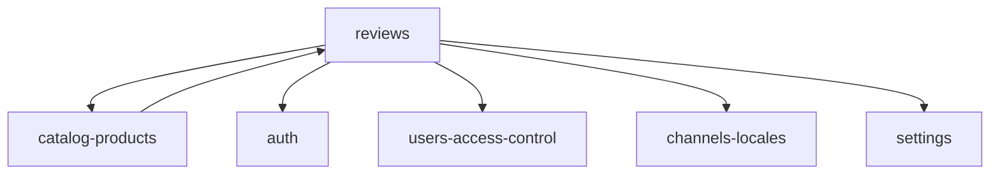

# Reviews — Dependencies

Module README: [README.md](README.md)

Verified from imports and call sites. Other modules are named to match this documentation set; they are not re-documented here.

```text
reviews
├── depends on
│   ├── catalog-products
│   ├── auth
│   ├── users-access-control   (permissions, role:Admin, Gate::before)
│   ├── channels-locales       (API group middleware; locale used in product slug lookup)
│   └── settings               (setting() keys on NewReviewMail / MailService only)
│
└── consumed by
    └── catalog-products       (approved rating avg/count on projection)
```



---

## Depends on: catalog-products

**Verified.**

| Reference | Where |
| --------- | ----- |
| `App\Models\Product` | API `resolveProduct()`; `ProductReview::product()`; admin eager-load `product.translations` |
| `status = 'active'` | API product query |
| `products.sku`, `products.id` | Resolve by id or SKU |
| `Product::translations()` / slug | Resolve by locale slug then any slug |
| `Product::translation()` | Admin list/edit display name |
| `Product::reviews()` | Inverse HasMany defined on Product |

Admin shows a deleted-product label when `$row->product` is missing (possible if the relation is null despite `cascadeOnDelete`—e.g. incomplete load). FK on delete is cascade from products.

This module does **not** create/update products.

---

## Depends on: auth

**Verified.**

| Reference | Where |
| --------- | ----- |
| `App\Models\User` | `ProductReview::user()`; policy; `$req->user()` |
| `$req->user()?->id/name/email` | API store payload |
| `ProductReviewPolicy` + `$this->authorize()` | API update/destroy when a user is present |
| Admin `auth` middleware | `routes/web.php` admin group |
| `User::HasApiTokens` | Auth module; tokens exist on User. Review routes are not in `auth:sanctum`. |

Fortify login/register are auth-owned. Reviews only consume the authenticated user when present.

---

## Depends on: users-access-control (observed extra)

Not in the coordinator “Deps: catalog-products, auth” list, but referenced:

- `review_view` / `review_edit` / `review_delete` seeded on module `Reviews`
- `check.permission` / `AutoAuthorizePermission`
- `role:Admin`
- `Gate::before` Super Admin and access-level permissions
- Spatie `HasRoles` on `User` (`hasAnyRole`, `$user->can`)

---

## Depends on: channels-locales (observed extra)

API review routes use `channel.api` and `locale.api`.

- Locale: `resolveProduct()` uses `app()->getLocale()` for translation slug.
- Channel: `ProductReviewController` does **not** filter by `currentChannel` / `channel_id`. Reviews are not channel-scoped in this controller.

---

## Depends on: settings / mail (observed extra)

`NewReviewMail` and `MailService::notifyAdminNewReview` read `setting('notifications.*')`. Store does not call the mail service. Settings module owns `config/settings.php` keys.

---

## Consumed by: catalog-products

**Verified.**

`ProductProjectionService` (when building projection payloads):

```text
->withAvg(['reviews as reviews_avg_rating' => fn ($q) => $q->where('status', 'approved')], 'rating')
->withCount(['reviews as reviews_count' => fn ($q) => $q->where('status', 'approved')])
```

Those values become `rating.avg` / `rating.count` via `ProductPayloadBuilder`.

`ProductProjectionDetailResource` sets `'reviews' => null` (comment: live reviews not included). Listing resources still expose `rating`.

`CompareResource` maps `rating.avg` from the product payload (wishlist-compare consuming catalog, not calling `ProductReviewController`).

Rebuilding projection after a new/approved review is **not** done in this module’s controllers. When aggregates refresh is **not determinable from this module’s code** (owned by catalog-products observers/jobs).

---

## Packages used here

| Package | Use |
| ------- | --- |
| `yajra/laravel-datatables-oracle` | Admin AJAX table (`composer.json` `^12.4`) |
| Laravel Mail / queue | `NewReviewMail` |
| Spatie Permission (via User + seeder) | Permission names and `role:Admin` |

---

## Explicitly not found

- Review-specific jobs, events, listeners, observers, repositories, actions, factories.
- Channel or locale columns on `product_reviews`.
- Callers of `MailService::notifyAdminNewReview()`.
