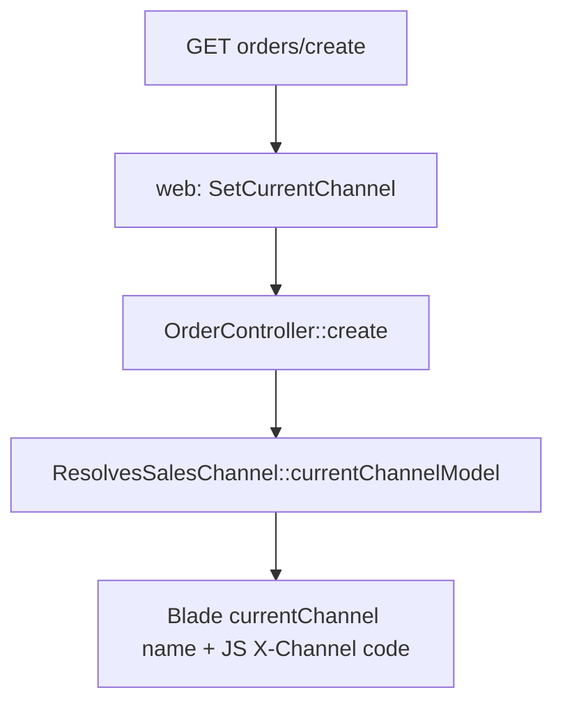
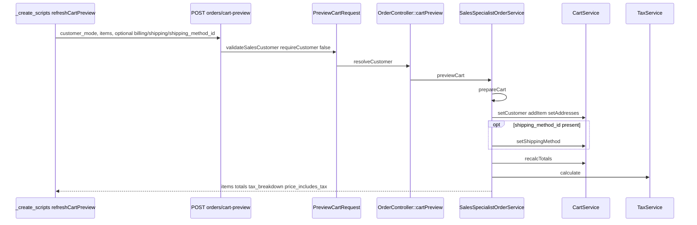
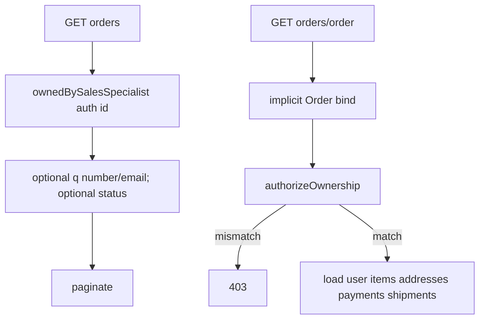

# Sales specialist — workflows

Mermaid matches methods and HTTP as implemented. Checkout internals after `OrderService::place()` are summarized as a single node; full place-order is [`../cart-checkout/workflows.md`](../cart-checkout/workflows.md).

## Create customer

UI: create-order modal `#newCustomerModal` → `#save-new-customer` posts JSON to `sales-specialist.customers.store`.

```mermaid
sequenceDiagram
    participant UI as orders/_create_scripts
    participant HTTP as POST /sales-specialist/customers
    participant Req as StoreCustomerRequest
    participant Ctrl as CustomerController::store
    participant DB as DB::transaction
    participant User as User / Role / UserGroup
    participant Obs as UserObserver::created

    UI->>HTTP: JSON name, email, phone
    HTTP->>Req: authorize true; unique email
    Req->>Ctrl: validated()
    Ctrl->>DB: begin
    DB->>User: User::create name email random password email_verified_at=now
    DB->>User: Role::firstOrCreate Customer web
    DB->>User: assignRole
    DB->>User: UserGroup firstOrCreate slug customer
    DB->>User: groups syncWithoutDetaching
    DB-->>Ctrl: User
    Ctrl-->>UI: 201 id text email name phone
    Note over Obs: afterCommit MailService::sendWelcome + notifyAdminNewUser
    UI->>UI: setCustomerMode existing; Select2 option; prefillBillingFromCustomer
```

`phone` is echoed in JSON for billing prefill in the **current page only**. It is not stored on `users`.

Guest checkout (`customer_mode=guest`) does **not** run this flow; no `User` row is created.

## Create order

### Channel before the form



### Live totals (optional, same scratch cart)



### Load shipping and payment (required before submit in the UI)

Tab `step-fulfillment` `shown.bs.tab` or `#refresh-fulfillment-options` calls `loadFulfillmentOptions()`.

```mermaid
sequenceDiagram
    participant UI as loadFulfillmentOptions
    participant HTTP as POST orders/fulfillment-options
    participant Req as PreviewFulfillmentRequest
    participant Ctrl as OrderController::fulfillmentOptions
    participant Svc as SalesSpecialistOrderService
    participant Cart as CartService
    participant Pay as PaymentDriverManager

    UI->>HTTP: existing/guest + items + billing (+ shipping unless same_as_billing)
    HTTP->>Req: customerPlacementRules true; billingRules; shippingRules
    Req->>Ctrl: resolveCustomer
    Ctrl->>Svc: previewFulfillment
    Svc->>Svc: prepareCart
    Svc->>Cart: shippingQuotes
    Svc->>Pay: driverFor; drop RedirectPaymentDriver; assertUsable
    Svc-->>UI: preview + shipping_quotes + payment_methods
    UI->>UI: fill shipping-method-select and payment-method-select
```

Redirect drivers (`RaiAcceptDriver`, `PcbBankDriver`) never appear in this picker.

### Submit

```mermaid
sequenceDiagram
    participant UI as POST order-form
    participant HTTP as POST /sales-specialist/orders
    participant Req as StoreOrderRequest
    participant Ctrl as OrderController::store
    participant Svc as SalesSpecialistOrderService
    participant Cart as CartService
    participant OS as OrderService::place

    UI->>HTTP: customer_mode, items, addresses, shipping_method_id, payment_method_id, customer_note
    HTTP->>Req: unique products; methods active forChannel currentChannel
    alt validation fail
        Req-->>UI: 422 / redirect with errors
    end
    Req->>Ctrl: resolveCustomer
    Ctrl->>Svc: placeForCustomer
    Svc->>Svc: ensureChannelBound
    Svc->>Svc: DB::transaction
    Svc->>Svc: prepareCart
    Svc->>Cart: setShippingMethod
    Svc->>Cart: setPaymentMethod
    Svc->>OS: place cart opts email note idempotency sales_specialist_id source
    Note over OS: source=sales_specialist; sales_specialist_id=Auth::id()
    alt RuntimeException
        OS-->>Ctrl: throw
        Ctrl-->>UI: back withInput errors.order
    else Order
        OS-->>Ctrl: Order
        Ctrl-->>UI: redirect sales-specialist.orders.show flash success
    end
```

Place opts are exactly:

- `email` — `resolveGuestEmail`
- `customer_note` — request or null
- `idempotency_key` — `sales-specialist:{authId}:{uuid}`
- `sales_specialist_id` — `Auth::id()`
- `source` — `Order::SOURCE_SALES_SPECIALIST`

After commit, `OrderObserver` (orders/auth mail path) still runs on the new `Order`. This module does not dispatch jobs itself.

## List and show



No status transition, payment capture, or shipment mutation on this prefix.
