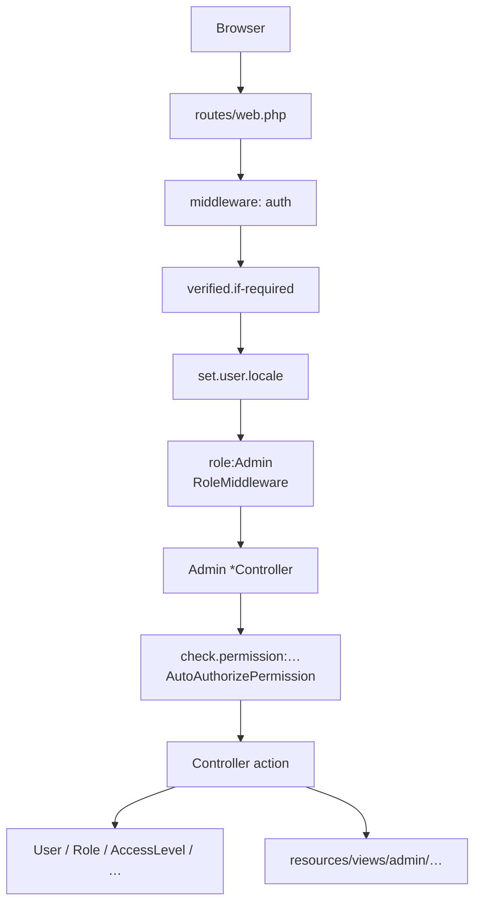
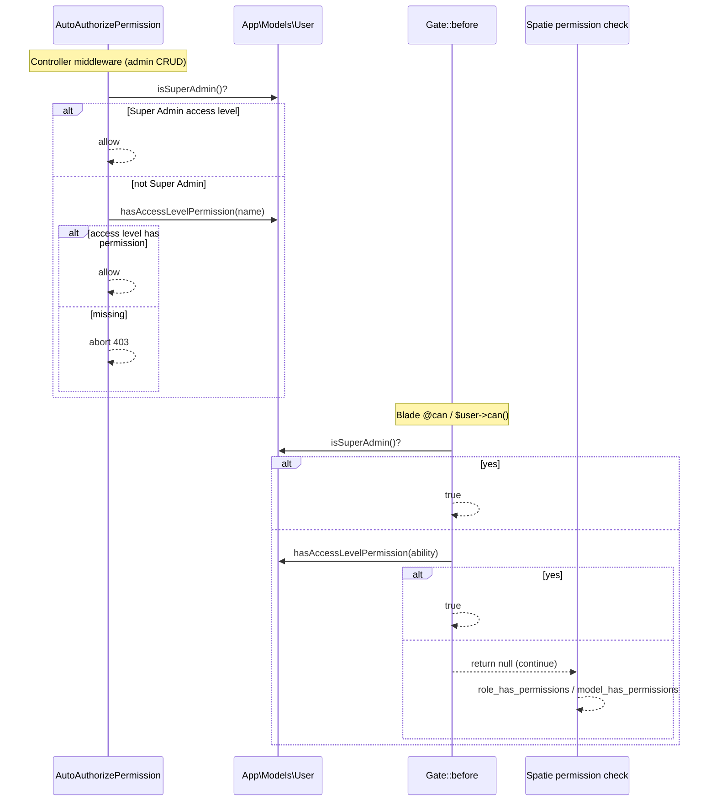

# Architecture

Back to [README](README.md).

## Style

Traditional Laravel MVC for this module. Controllers talk to Eloquent (and Spatie) directly. The only dedicated service is `UserAddressService`. There is no repository layer, no domain events owned here, and no jobs.

Admin list pages use Yajra DataTables (`Yajra\DataTables\Facades\DataTables`) over Eloquent, returning JSON when `Request::ajax()` is true.

## Two Parallel Authorization Systems

| Layer | Implementation | What it decides |
| ----- | -------------- | --------------- |
| Spatie roles | `spatie/laravel-permission` `HasRoles` on `User`; tables `roles`, `model_has_roles` | Which **area** the user may enter: `/admin/*`, `/customer/*`, `/sales-specialist/*` |
| Access levels | `access_levels` + `access_level_permission` + `user_access_level` | Which **named operations** (`user_view`, `order_edit`, …) succeed |

They are not wired together in application code:

- Role admin UI (`RoleController`) only creates/renames/deletes a role **name**. The edit form has no permission checkboxes.
- `routes/web.php` registers `admin.roles.attach.permissions` → `RoleController::attachPermissions`, but **that method does not exist** on the controller.
- No `givePermissionTo` / `syncPermissions` calls under `app/`.
- Spatie config still uses `Spatie\Permission\Models\Permission` (`config/permission.php`). Admin CRUD uses `App\Models\Permission` on the **same** `permissions` table (extra column `module_id`).

### Super Admin

Not a Spatie role. Seeded access level named exactly `Super Admin` (`database/seeders/SuperAdminSeeder.php`).

`User::isSuperAdmin()` (`app/Models/User.php`) is true when that access level is attached.

Bypass sites:

1. `Gate::before` in `app/Providers/AuthServiceProvider.php` — returns `true` for any ability
2. `AutoAuthorizePermission` — skips the named permission check

A user who is Super Admin still needs Spatie role `Admin` to pass `role:Admin` and reach `/admin/*`.

## Request Lifecycle (Admin)



`role` and `check.permission` aliases are registered in `bootstrap/app.php`.

`SetCurrentChannel` is appended to the `web` group (`bootstrap/app.php`) and reads `User::channels()` / `current_channel_id`. That middleware is owned by channels-locales; this module stores the assignments.

## Authorization Decision Order



**Consequence:** Blade `@can('user_view')` can theoretically succeed via Spatie if a role ever received that permission. Controller `check.permission:user_view` **cannot** — it only looks at access levels. Today nothing assigns Spatie permissions, so both paths effectively require an access level (or Super Admin).

`hasAccessLevelPermission()` loads `accessLevels` then `permissions` and matches on `permissions.name`. It does not eager-load in middleware; each check may lazy-load.

## Spatie Roles vs Home / Login

`GET /` (`routes/web.php`):

1. Guest → `login`
2. `hasRole('Admin')` → `admin.dashboard`
3. `hasRole('Sales Specialist')` → `sales-specialist.dashboard`
4. `hasRole('Customer')` → `customer.dashboard`
5. Else → `customer.dashboard` (still behind `role:Customer` on that route)

Fortify `LoginResponse` (`app/Providers/FortifyServiceProvider.php`, auth module): `Customer` first, then `Sales Specialist`, else `admin.dashboard`.

A user with **both** `Customer` and `Admin` is sent to the customer dashboard on login.

Seeded role **`User`** is not tested by those branches. Login would send them to `admin.dashboard`, which requires `role:Admin` → 403 unless they also have `Admin`.

## Permission Catalog

```text
modules 1──* permissions
access_levels *──* permissions   (access_level_permission)
users *──* access_levels          (user_access_level)
users *──* roles                 (model_has_roles, Spatie)
users *──* user_groups            (user_group_user)
users *──* channels               (channel_user)
users 1──* user_addresses
```

`App\Models\Module` is a **catalog grouping** for the permission admin UI (access-level checkboxes grouped by module name in `resources/views/admin/access_levels/_permissions_cards.blade.php`). It is not a Laravel package module and not a PHP namespace.

### Unused “Posts” module

`database/seeders/ModulePermissionSeeder.php` includes:

```text
'Posts' => [ 'post' => ['view', 'create', 'edit', 'delete'] ]
```

That creates module `Posts` and permissions `post_view`, `post_create`, `post_edit`, `post_delete`. There is no Posts feature in `app/` (no controller, model, routes, or views). Documented as observed seed data only — not a Posts module.

## Employees vs Users

`Employee` is a separate table with its own email uniqueness. Admin CRUD lives under `/admin/employees` (Laravel resource). `resources/views/layouts/components/main-sidebar.blade.php` has **no** employees link. Reachable by URL if the user has `employee_*` permissions (or Super Admin) **and** role `Admin`.

## Addresses: Two Implementations

| Path | Default-flag logic |
| ---- | ------------------ |
| Admin | `UserAddressService` — transaction, clear other defaults (including soft-deleted), promote latest if none remain after delete |
| API | `AddressController` private helpers — similar clear-on-write; `destroy` does **not** promote; does not call `UserAddressService` |

Schema also uses generated unique columns `default_shipping_user` / `default_billing_user` (`database/migrations/2025_08_27_235541_create_user_addresses_table.php.php`) so MySQL can enforce one default per user among non-null generated values.

## Observer Side Effect

`EventServiceProvider` registers `User::observe(UserObserver::class)`.

`created` always queues `MailService::sendWelcome` and `notifyAdminNewUser` after commit. That includes `DatabaseSeeder` user inserts, admin user create, API register, and sales-specialist customer create.

## Observed Gaps (facts, not recommendations)

| Observation | Evidence |
| ----------- | -------- |
| `RoleController::attachPermissions` missing | Route in `routes/web.php` line 119; method absent from `app/Http/Controllers/Admin/RoleController.php` |
| `User::manualRoles()` uses pivot `role_user` | No `role_user` migration; method unused outside the model |
| Laravel `Route::resource` registers `show` for access levels, modules, permissions | Those controllers have no `show()` |
| Employee status enum vs form | Migration `active\|inactive\|on_leave`; form + validation `active\|inactive\|terminated` |
| Admin address form has `company` but no `nui` field | `StoreUserAddressRequest` requires `nui` when `company` is present |
| Employees not in sidebar | Sidebar Users / Access Control sections only |
| `Posts` permissions seeded, unused | `ModulePermissionSeeder` |
| API vs admin address delete behavior differs | `AddressController::destroy` vs `UserAddressService::delete` |

## Packages

| Package | Use in this module |
| ------- | ------------------ |
| `spatie/laravel-permission` ^6.21 | Roles, `HasRoles`, `hasRole` / `hasAnyRole` / `User::role()` |
| `yajra/laravel-datatables-oracle` ^12.4 | Admin index JSON |
| `laravel/sanctum` | `User` `HasApiTokens`; API address routes behind `auth:sanctum` |
| `laravel/fortify` | `TwoFactorAuthenticatable` on `User`; 2FA columns on `users` |
