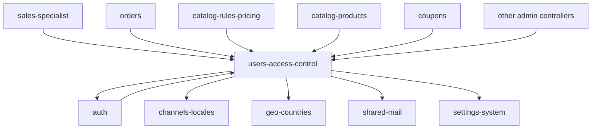

# Dependencies

Back to [README](README.md).

Outgoing = this module’s code references another module’s types. Incoming = other modules reference this module’s users/roles/groups/addresses/permissions.

```text
users-access-control
├── depends on
│   ├── auth
│   ├── channels-locales
│   ├── countries (geo-countries)
│   ├── mail (docs/shared)
│   └── settings-system (API address field flags only)
│
└── consumed by
    ├── auth
    ├── sales-specialist
    ├── orders
    ├── catalog-rules-pricing
    ├── catalog-products (projections / search / facets)
    ├── coupons
    ├── carts / checkout
    └── nearly all admin modules (check.permission)
```



---

## Depends on: auth

| Reference | Path / class |
| --------- | ------------- |
| Session auth on admin routes | `middleware(['auth', …])` in `routes/web.php` |
| Sanctum on address API | `auth:sanctum` in `routes/api.php`; `User` uses `HasApiTokens` |
| `verified.if-required` | `bootstrap/app.php` |
| Fortify 2FA trait + columns | `TwoFactorAuthenticatable` on `User`; migration `2025_08_06_134009_add_two_factor_columns_to_users_table.php` |
| `AuthSettings` | `User::sendEmailVerificationNotification` / `sendPasswordResetNotification` |
| Notifications | `VerifyEmailNotification`, `ResetPasswordNotification` (owned by auth) |

This module does **not** own Fortify actions or `AuthController`.

---

## Depends on: channels-locales

| Reference | Path / class |
| --------- | ------------- |
| Assign channels on user create/edit | `UserController`; `User::channels()`; table `channel_user` |
| `current_channel_id` | `users` column; `User::currentChannel()` |
| `User.locale` | `SetUserLocale` reads it (middleware owned by channels-locales) |
| `Channel::all()` on user forms | `App\Models\Channel` |

`SetCurrentChannel` (web group) uses `User::channels()` / `current_channel_id`. Owned by channels-locales; data is written here.

---

## Depends on: [geo-countries](../geo-countries/README.md)

| Reference | Path / class |
| --------- | ------------- |
| Admin country dropdown + DataTables label | `UserAddressController` → `Country` |
| Validation | `exists:countries,code` |
| API country name map | `AddressController::countryNameMap()` |

---

## Depends on: [mail](../../shared/README.md#mail)

`UserObserver` constructor-injects `App\Services\Mail\MailService` and calls `sendWelcome` / `notifyAdminNewUser`.

---

## Depends on: [settings-system](../settings-system/README.md) (API only)

`AddressController` uses `App\Support\CheckoutAddressFields` (`show`, `required`, `nuiRequiredIfCompany`) so storefront address validation follows checkout settings. Admin FormRequests do **not** use that helper.

---

## Consumed by: auth

| Reference | Path |
| --------- | ---- |
| `User` create + `Customer` role + `customer` group | `app/Http/Controllers/Api/V1/AuthController.php` |
| Fortify `CreateNewUser` | creates `User` without role/AL |
| Login redirects by role | `app/Providers/FortifyServiceProvider.php` |
| `AuthUserPayload` | `id`, `name`, `email`, `email_verified` only |

---

## Consumed by: sales-specialist

| Reference | Path |
| --------- | ---- |
| Customer search/create | `app/Http/Controllers/SalesSpecialist/CustomerController.php` |
| `User::role('Customer')` | `SalesSpecialist\OrderController`, `ValidatesSalesCustomer` |
| `StoreCustomerRequest` | unique `users.email` |

---

## Consumed by: orders

| Reference | Path |
| --------- | ---- |
| `Order::user()` | `app/Models/Order.php` |
| `Order::salesSpecialist()` | `sales_specialist_id` → `User` |
| Admin order address PATCH | **`OrderAddress`**, not `UserAddress` |

---

## Consumed by: catalog-rules-pricing, catalog-products, coupons, carts

| Reference | Path |
| --------- | ---- |
| `CatalogRule::userGroups()` | `catalog_rule_user_groups` |
| `Coupon::userGroups()` | `coupon_user_groups` |
| Projection / search / facet / cart price | `user_group_id` vs `user_group_user` membership |
| `UserGroup` in indexer | `app/Services/Catalog/CatalogRuleIndexer.php` |

---

## Consumed by: other admin modules

Every admin controller that sets `check.permission:{name}` depends on:

- `bootstrap/app.php` alias
- `AutoAuthorizePermission`
- `User::isSuperAdmin` / `hasAccessLevelPermission`
- Seeded permission names from `ModulePermissionSeeder` / `SuperAdminSeeder`

Horizon: `app/Providers/HorizonServiceProvider.php` `hasRole('Admin')`.

Product reviews: `ProductReviewPolicy` uses `User` id + `$user->can('review_*')`.

---

## Packages

| Package | Where |
| ------- | ----- |
| `spatie/laravel-permission` | `User` HasRoles, `Role` CRUD, `RoleMiddleware`, seeders |
| `yajra/laravel-datatables-oracle` | Admin indexes |
| `laravel/sanctum` | API addresses + `HasApiTokens` |
| `laravel/fortify` | 2FA on `User` |

---

## Shared views

`resources/views/layouts/components/main-sidebar.blade.php` and `main-header1.blade.php` branch on `hasRole('Admin'|'Customer'|'Sales Specialist')`. Not owned by this module’s view folder, but they are the UI entry to it.
