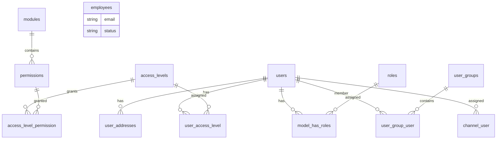

# Models

Back to [README](README.md).

Spatie `Role` is not an `App\Models` class. Admin role CRUD uses `Spatie\Permission\Models\Role`. Config: `config/permission.php` → `'role' => Spatie\Permission\Models\Role::class`.

---

## `App\Models\User`

Source: `app/Models/User.php`

### Purpose

Authenticatable account for admin, sales specialist, customer, and storefront API. Implements `MustVerifyEmail`. Uses Fortify 2FA, Spatie `HasRoles`, Sanctum tokens.

### Table

```text
users
```

### Important Fields

| Field | Type (migrations) | Purpose |
| ----- | ------------------ | ------- |
| `id` | bigint PK | |
| `current_channel_id` | FK `channels.id`, nullable | Selected admin/store channel |
| `name` | string | Display name |
| `email` | string, unique | Login + notifications |
| `email_verified_at` | timestamp, nullable | Verification |
| `password` | string | Hashed (`casts`: `hashed`) |
| `two_factor_secret` | text, nullable | Fortify 2FA |
| `two_factor_recovery_codes` | text, nullable | Fortify 2FA |
| `two_factor_confirmed_at` | timestamp, nullable | Fortify 2FA |
| `locale` | string(5), default `en` | `SetUserLocale` |
| `preferences` | json, nullable | Cast to `array`; no writers found in this module |
| `remember_token` | string | Session remember |
| `created_at` / `updated_at` | timestamps | |

`$hidden`: `password`, `remember_token`. `$fillable` includes `email_verified_at` (admin create sets it to `now()`).

### Casts

| Attribute | Cast |
| --------- | ---- |
| `email_verified_at` | `datetime` |
| `password` | `hashed` |
| `preferences` | `array` |

### Relationships

| Method | Relationship | Related | Description |
| ------ | ------------ | ------- | ----------- |
| `roles()` | Spatie `HasRoles` morph | `Spatie\Permission\Models\Role` via `model_has_roles` | Area roles |
| `manualRoles()` | `belongsToMany` Role, pivot `role_user` | Spatie `Role` | **Unused.** No `role_user` table migration |
| `accessLevels()` | `belongsToMany` | `AccessLevel` via `user_access_level` | Permission bundles |
| `groups()` | `belongsToMany` | `UserGroup` via `user_group_user` | Pricing / membership groups |
| `addresses()` | `hasMany` | `UserAddress` | Address book |
| `defaultShippingAddress()` | `hasOne` + `where is_default_shipping` | `UserAddress` | |
| `defaultBillingAddress()` | `hasOne` + `where is_default_billing` | `UserAddress` | |
| `channels()` | `belongsToMany` | `Channel` via `channel_user` | Allowed channels |
| `currentChannel()` | `belongsTo` | `Channel` on `current_channel_id` | |

### Business Methods

| Method | Behavior |
| ------ | -------- |
| `isSuperAdmin(): bool` | Access level name `Super Admin` (uses loaded relation if present) |
| `hasAccessLevelPermission(string $permission): bool` | Unique permission names from attached access levels; `contains($permission)` |
| `sendEmailVerificationNotification()` | No-op if verification disabled or already verified; else `VerifyEmailNotification` (auth) |
| `sendPasswordResetNotification($token)` | Throws `ValidationException` if reset disabled; else `ResetPasswordNotification` (auth) |

### Scopes / Accessors

None defined on the model. Spatie adds `role()` / `permission()` query scopes via `HasRoles`.

### Events / Observers

`UserObserver` (`app/Observers/UserObserver.php`), registered in `app/Providers/EventServiceProvider.php`.

`created`: `DB::afterCommit` → `MailService::sendWelcome($user)` and `MailService::notifyAdminNewUser($user)`.

No `deleting` observer; `UserController::delete` is a hard delete (`User` has no `SoftDeletes`).

### Factory

`database/factories/UserFactory.php` — `name`, unique `email`, verified, password hash of `password`, random remember token. `unverified()` state.

---

## `App\Models\AccessLevel`

Source: `app/Models/AccessLevel.php`

### Purpose

Named set of permissions assigned to users. Seeded instance: `Super Admin` (“Full access — every permission”).

### Table

```text
access_levels
```

### Important Fields

| Field | Type | Purpose |
| ----- | ---- | ------- |
| `id` | bigint PK | |
| `name` | string, unique | Matched by `isSuperAdmin()` when `'Super Admin'` |
| `description` | string, nullable | |
| timestamps | | |

### Relationships

| Method | Relationship | Related | Pivot |
| ------ | ------------ | ------- | ----- |
| `permissions()` | `belongsToMany` | `App\Models\Permission` | `access_level_permission` |
| `users()` | `belongsToMany` | `User` | `user_access_level` |

No casts, scopes, or observers.

---

## `App\Models\Permission`

Source: `app/Models/Permission.php`

### Purpose

Application catalog row for a named ability (`user_view`, `order_edit`, …), grouped under a `Module`.

**Does not extend** `Spatie\Permission\Models\Permission` and does not implement Spatie’s contract. Spatie is configured to use its own model on the same `permissions` table (`config/permission.php`).

### Table

```text
permissions
```

### Important Fields

| Field | Type | Purpose |
| ----- | ---- | ------- |
| `id` | bigint PK | |
| `name` | string | Ability string used by middleware and `@can` |
| `guard_name` | string | Admin create/update always `'web'` |
| `module_id` | FK `modules.id`, cascade delete | Catalog group |
| timestamps | | |

Unique: `(name, guard_name)` from Spatie migration.

### Relationships

| Method | Relationship | Related | Pivot |
| ------ | ------------ | ------- | ----- |
| `module()` | `belongsTo` | `Module` | |
| `accessLevels()` | `belongsToMany` | `AccessLevel` | `access_level_permission` |

---

## `App\Models\Module`

Source: `app/Models/Module.php`

### Purpose

Display/group name for permissions in admin UI and seeders. Not a code module.

### Table

```text
modules
```

### Important Fields

| Field | Type | Purpose |
| ----- | ---- | ------- |
| `name` | string, unique | e.g. `Users`, `Access Control`, `Posts` |
| `description` | string, nullable | Optional; create/update accepts it |

### Relationships

| Method | Relationship | Related |
| ------ | ------------ | ------- |
| `permissions()` | `hasMany` | `Permission` |

Deleting a module cascades to `permissions` (`module_id` FK `onDelete('cascade')`), which then cascades Spatie and access-level pivots.

---

## `App\Models\UserGroup`

Source: `app/Models/UserGroup.php`

### Purpose

Named membership group (pricing, coupons, catalog rules, storefront projections). Soft-deletable.

### Table

```text
user_groups
```

### Important Fields

| Field | Type | Purpose |
| ----- | ---- | ------- |
| `name` | string, unique | |
| `slug` | string, unique | Auto-set from name if empty |
| `description` | text, nullable | |
| `is_active` | boolean, default true | User create form only lists active groups |
| `deleted_at` | SoftDeletes | |

### Relationships

| Method | Relationship | Related | Pivot |
| ------ | ------------ | ------- | ----- |
| `users()` | `belongsToMany` | `User` | `user_group_user` |

### Model Hooks

`booted()`:

- `creating`: if `slug` empty → `Str::slug($name)`
- `updating`: if `name` dirty and `slug` not dirty → slug follows name

Admin create can pass an explicit slug. On update, empty slug in the request keeps `$group->slug` (`UserGroupController::edit`).

Controller comment on `delete()` says “FK cascades remove pivot rows”. `delete()` is **soft** delete; SQL `ON DELETE CASCADE` on `user_group_user` does not run until a hard delete. Soft-deleted groups are hidden from `UserGroup` queries; `$user->groups()` also omits them via SoftDeletes on the related model. Pivot rows remain until a real DELETE.

---

## `App\Models\UserAddress`

Source: `app/Models/UserAddress.php`

### Purpose

Saved address for a user (admin address book + storefront `/me/addresses`). Soft-deletable.

### Table

```text
user_addresses
```

### Important Fields

| Field | Type | Purpose |
| ----- | ---- | ------- |
| `user_id` | FK users, cascade | Owner |
| `label` | string(100), nullable | e.g. Home |
| `first_name` / `last_name` | string(100) | |
| `company` | string(150), nullable | |
| `nui` | string(100), nullable | Added in `2026_04_02_120000_add_nui_to_user_addresses_table.php` |
| `phone` | string(50), nullable | |
| `address_line1` | string(191) | API maps `address1` → this |
| `address_line2` | string(191), nullable | API maps `address2` |
| `city` | string(120) | |
| `state_code` | string(60), nullable | |
| `postcode` | string(40), nullable | |
| `country_code` | string(2) | ISO alpha-2; validated against `countries.code` |
| `is_default_shipping` | boolean | |
| `is_default_billing` | boolean | |
| `default_shipping_user` | generated virtual | Unique; `user_id` when shipping default else NULL |
| `default_billing_user` | generated virtual | Unique analog |
| `meta` | json, nullable | Cast `array` |
| `deleted_at` | SoftDeletes | |

### Casts

`is_default_shipping`, `is_default_billing` → `boolean`; `meta` → `array`.

### Relationships

| Method | Relationship | Related |
| ------ | ------------ | ------- |
| `user()` | `belongsTo` | `User` |

No observers. Default exclusivity is enforced in `UserAddressService` / `AddressController`, plus the generated unique columns.

---

## `App\Models\Employee`

Source: `app/Models/Employee.php`

### Purpose

HR-style staff record. **No relationship to `User`.**

### Table

```text
employees
```

### Important Fields

| Field | Type (migration) | Notes |
| ----- | ----------------- | ----- |
| `first_name` / `last_name` | string | |
| `email` | string, unique | Independent of `users.email` |
| `phone` | string, nullable | |
| `position` / `department` | string, nullable | |
| `hired_at` | date, nullable | Cast `date` |
| `salary` | decimal(12,2), nullable | Controller validation **required** |
| `status` | enum `active`, `inactive`, `on_leave` default `active` | Form uses `terminated` instead of `on_leave` |
| `avatar_path` | string, nullable | `storage/app/public/uploads/avatars` |
| `deleted_at` | SoftDeletes | |

### Accessors

`getFullNameAttribute()`: `trim(first_name + last_name)`.

No relationships, scopes, or observers.

---

## Spatie `Role` (used as if local)

Class: `Spatie\Permission\Models\Role`  
Table: `roles` (`name` + `guard_name` unique). Seeded names: `Admin`, `User`, `Customer`, `Sales Specialist` (`database/seeders/RoleSeeder.php`).

Assigned via `$user->syncRoles()` / `assignRole()` / `User::role('Customer')`.

---

## ER (this module)


