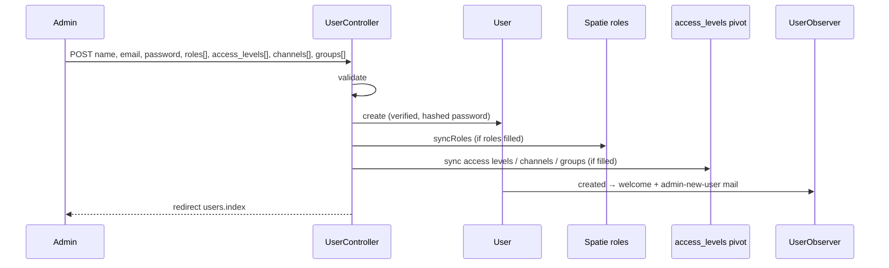

# Workflows

Back to [README](README.md).

---

## 1. Seed bootstrap (local identity)

**Trigger:** `php artisan db:seed` → `DatabaseSeeder`

```text
User::firstOrCreate (four emails)
    ↓
UserObserver::created → MailService (after commit)
    ↓
UserGroupSeeder (General, Wholesale, VIP, Guest)
    ↓
… other module seeders …
    ↓
ModulePermissionSeeder (modules + permissions, including unused Posts)
    ↓
SuperAdminSeeder (Access Control module, Super Admin AL, sync all permissions, attach to admin user)
    ↓
RoleSeeder (four Spatie roles; assign by user id 1–4)
```

After a successful seed matching that order: user 1 has role `Admin` **and** access level `Super Admin`. That combination is what can enter `/admin/*` and pass every `check.permission`.

---

## 2. Admin creates a staff user

**Trigger:** `POST /admin/users/create` (`UserController::create`)



Without an access level (and without Super Admin), the new user cannot pass `check.permission` even with role `Admin`. Without role `Admin`, they cannot enter `/admin/*`.

---

## 3. Admin panel authorization

**Trigger:** Any `/admin/*` request after login

```text
auth → verified.if-required → set.user.locale
    → RoleMiddleware: hasAnyRole('Admin')
    → AutoAuthorizePermission: Super Admin OR accessLevels.permissions.name
```

Sidebar visibility uses `@can` / `@canany` (Gate), not the middleware alias.

---

## 4. Storefront customer registration (auth module writing this module)

**Trigger:** `POST /api/v1/auth/register`

```text
AuthController::register
    → User::create
    → Role::firstOrCreate('Customer') → assignRole
    → UserGroup::firstOrCreate slug customer → syncWithoutDetaching
    → optional email verification
    → UserObserver mail
```

Group `customer` is created on first register if missing; it is not in `UserGroupSeeder`.

---

## 5. Sales specialist creates a customer

**Trigger:** `POST /sales-specialist/customers` (`SalesSpecialist\CustomerController::store`)

Requires Spatie role `Sales Specialist` (route group). Creates `User` with `str()->random(32)` password (hashed by the model cast), `email_verified_at = now()`, `Customer` role, `customer` group. Returns JSON 201 for the order-create UI. The random password is not returned; the customer cannot log in until some other auth flow sets a password (not implemented in this controller).

Search: `GET /sales-specialist/customers/search` → `User::role('Customer')`.

---

## 6. Admin address defaults

**Trigger:** `POST /admin/addresses` or `PUT /admin/addresses/{id}` or `DELETE /admin/addresses/{id}`

```text
UserAddressController
    → StoreUserAddressRequest / UpdateUserAddressRequest
    → UserAddressService::{create|update|delete} inside DB::transaction
        → clear other defaults (withTrashed when setting a default)
        → enforceDefaults / ensureOneDefault
```

First address for a user becomes both default shipping and billing if no other default exists.

---

## 7. Storefront address book

**Trigger:** `/api/v1/me/addresses*`

Same table, different code path (`AddressController`). Delete does not promote defaults. `POST …/default` with `type` shipping|billing|both.

Grouped JSON (`personal` / `company` / `address` / `defaults`) is flattened before validate.

---

## 8. User groups in pricing (consumer workflow)

This module owns group membership. Other modules **read** `user_group_user`:

- Catalog rules: `CatalogRule::userGroups()` pivot `catalog_rule_user_groups`
- Coupons: `Coupon::userGroups()` pivot `coupon_user_groups`
- Product projections / search / facets / cart pricing: `user_group_id` on projection/price rows vs the current user’s group ids

Empty catalog-rule group selection means the rule applies to all users including guests (admin copy in translations; indexer owned by catalog-rules-pricing).

Not documented further here.

---

## Not a workflow in this module

- Fortify login/register/2FA/password reset → auth
- Horizon allow-list → uses `hasRole('Admin')` but lives in Horizon provider
- Order shipping/billing snapshots → `OrderAddress`, not `user_addresses`
