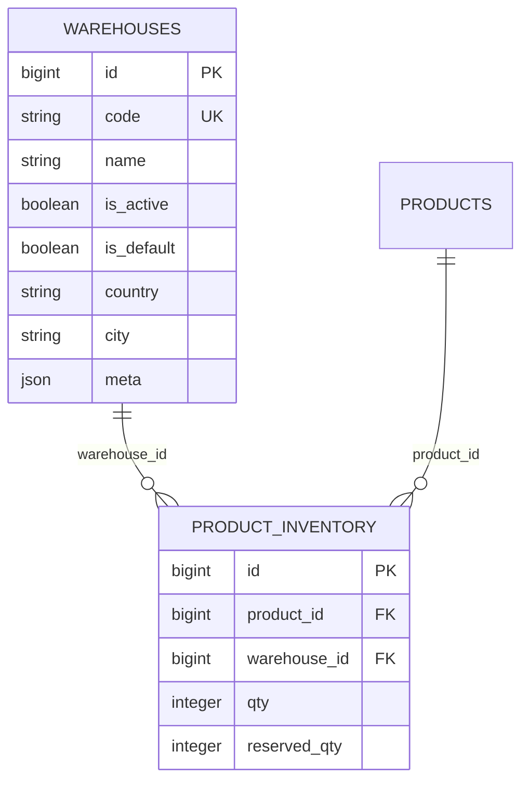

# Database — Warehouses & Inventory

Back to [module README](README.md). Models: [models.md](models.md).

Migrations are the source for column types. Seeders listed are the writers of warehouse/inventory rows.

---

## ER (this module)

`products` is owned by [catalog-products](../catalog-products/README.md).

---

## Table: `warehouses`

### Purpose

Warehouse master data for admin CRUD and as the FK target for `product_inventory.warehouse_id`.

### Columns

| Column | Type | Nullable | Default | Description |
| ------ | ---- | -------- | ------- | ----------- |
| `id` | bigint unsigned | no | autoincrement | Primary key |
| `code` | string | no | — | Unique warehouse code |
| `name` | string | no | — | Display name |
| `is_active` | boolean | no | `true` | Active flag |
| `is_default` | boolean | no | `false` | Default warehouse flag |
| `country` | string | yes | `null` | Free-text; not an FK |
| `city` | string | yes | `null` | Free-text; not an FK |
| `meta` | json | yes | `null` | Unused by warehouse admin |
| `created_at` | timestamp | yes | — | |
| `updated_at` | timestamp | yes | — | |

### Primary Key

`id`

### Foreign Keys

None.

### Indexes

| Index | Columns |
| ----- | ------- |
| Unique | `code` |

### Unique Constraints

- `code` unique.

`is_default` is **not** unique in the schema. Single-default behavior is enforced in `WarehouseController` by updating other rows to `is_default = false` inside `DB::transaction`.

### Relationships

- One warehouse has many `product_inventory` rows (`warehouse_id`, cascade on warehouse delete).

### Created By

`database/migrations/2026_03_18_154902_create_warehouses_table.php`

`down()`: `Schema::dropIfExists('warehouses')`.

---

## Table: `product_inventory`

### Purpose

Per-product, per-warehouse on-hand and reserved quantities. Current Eloquent mapping: `App\Models\ProductInventory`.

### Columns

| Column | Type | Nullable | Default | Description |
| ------ | ---- | -------- | ------- | ----------- |
| `id` | bigint unsigned | no | autoincrement | Primary key; FIFO deduct orders by this |
| `product_id` | foreignId | no | — | `constrained()` → `products`, `cascadeOnDelete` |
| `warehouse_id` | foreignId | no | — | `constrained()` → `warehouses`, `cascadeOnDelete` |
| `qty` | integer | no | `0` | On-hand |
| `reserved_qty` | integer | no | `0` | Reserved (availability subtract) |
| `created_at` | timestamp | yes | — | |
| `updated_at` | timestamp | yes | — | |

Laravel `foreignId()->constrained()` creates unsigned bigint FKs; `warehouse_id` is **not nullable**.

### Primary Key

`id`

### Foreign Keys

| Column | References | On delete |
| ------ | ---------- | --------- |
| `product_id` | `products.id` | cascade |
| `warehouse_id` | `warehouses.id` | cascade |

### Indexes / Unique Constraints

| Constraint | Columns |
| ---------- | ------- |
| Unique | `product_id`, `warehouse_id` |

### Relationships

- Belongs to product and warehouse.
- Product delete removes inventory rows.
- Warehouse delete removes inventory rows for that warehouse.

### Created By

`database/migrations/2026_03_18_161339_create_product_inventory_table_v2.php`

`down()` drops **`product_inventory_table_v2`**, not `product_inventory`. Rollback of this migration would not drop the table created in `up()`.

---

## Legacy table: `product_inventories`

Created in `database/migrations/2025_08_25_153836_create_products_table.php` (comment: “INVENTORY (per product for now; can evolve to per-warehouse)”).

Columns include `product_id` (unique), `manage_stock`, `qty`, `is_in_stock`, `backorders`, `low_stock_threshold`.

**No current model uses this table.** `ProductInventory` explicitly uses `product_inventory`. No later migration in this repository drops `product_inventories`. If both tables exist at runtime, only `product_inventory` is the live stock store for application code searched in this pass.

---

## Seeders

### `Database\Seeders\WarehouseSeeder`

Source: `database/seeders/WarehouseSeeder.php`

Called from `DatabaseSeeder` after `ChannelSeeder`, `CountrySeeder`, `ShippingGroupSeeder`, `CitySeeder`.

`updateOrCreate` on `code`:

| code | name | is_active | is_default | country | city |
| ---- | ---- | --------- | ---------- | ------- | ---- |
| `default` | Main Warehouse | true | true | `XK` | Main City |

`meta` is not set.

### `Database\Seeders\DemoCatalogSeeder`

Commented out in `DatabaseSeeder`. When run, loads `Warehouse::all()` and for each demo product, `ProductInventory::updateOrCreate` per warehouse with random `qty` `0..120` and `reserved_qty` `rand(0, (int)(qty * 0.2))`.

### Permissions

`ModulePermissionSeeder` module name `Warehouses`, resource prefix `warehouse`, actions `view`, `create`, `edit`, `delete` → permission names `warehouse_view`, `warehouse_create`, `warehouse_edit`, `warehouse_delete` (`guard_name` `web`).

---

## Factories

No `WarehouseFactory` or `ProductInventoryFactory` under `database/factories`.
