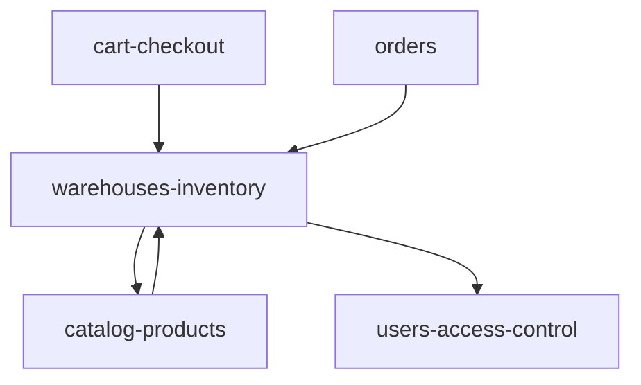

# Dependencies — Warehouses & Inventory

Back to [module README](README.md).

Dependencies are from FKs, `use` statements, routes, and middleware. Suggested `channels-locales` was **verified and not found** as a dependency of this module’s owned classes.

```text
warehouses-inventory
├── depends on
│   ├── catalog-products     (products table / Product model)
│   └── users-access-control (admin guard, role:Admin, warehouse_* permissions)
│
└── consumed by
    ├── catalog-products     (product form, ProductService, projections, filters)
    ├── cart-checkout        (OrderService, CartService bundle checks)
    └── orders               (cancel restock, credit-note restock)
```



`catalog-products` both **depends on** warehouses (inventory FK, `Warehouse::active()` on the product form) and **is depended on** by this module (`product_id`). That is a real bidirectional coupling at the data layer: inventory rows cannot exist without products; products store stock in this module’s table.

---

## Outgoing

### catalog-products — confirmed

| Evidence | Detail |
| -------- | ------ |
| FK | `product_inventory.product_id` → `products.id` cascade delete |
| Model | `ProductInventory::product()` → `Product` |
| Inverse | `Product::inventories()`, `availableQty()`, `DEFAULT_NEW_STOCK_QTY` |

### users-access-control — confirmed

| Evidence | Detail |
| -------- | ------ |
| Routes | `auth`, `role:Admin` |
| Permissions | `warehouse_view/create/edit/delete` via `AutoAuthorizePermission` |
| Seeder | `ModulePermissionSeeder` module `Warehouses` |

### channels-locales — **not confirmed**

Checked: `Warehouse.php`, `ProductInventory.php`, `WarehouseController.php`, warehouse migrations, `WarehouseSeeder`.

| Claim | Result |
| ----- | ------ |
| Channel FK on warehouses | None |
| Locale FK | None |
| `Channel` / `Locale` imports | None on owned classes |
| Stock scoped by channel | Availability sums all warehouse rows; not filtered by `channel_id` |
| `country` / `city` | Unconstrained strings (seeder uses `XK` / `Main City`), not `locales` or `countries` FKs |

`DatabaseSeeder` runs `WarehouseSeeder` after `ChannelSeeder` / `LocaleSeeder` neighbors, but `WarehouseSeeder` does not read those tables.

Catalog **product** create/edit loads both `Warehouse::active()` and the current channel in `ProductController`. That is catalog-products depending on **both** modules independently, not warehouses depending on channels.

---

## Incoming (consumers)

| Module | How it uses this module |
| ------ | ------------------------ |
| catalog-products | `ProductService` / `ConfigurableProductService` write `ProductInventory`; product views `_inventory.blade.php`; filters/export/projections/rental total units read inventories |
| cart-checkout | `OrderService` lock/check/deduct; `CartService` bundle `availableQty()` |
| orders | `OrderController::performCancel` restock; `CreditNoteService` optional restock |

CMS widgets (`in_stock_only`) and API product resources read **projection** `in_stock`, which was derived from `availableQty()` at rebuild time — catalog-products, not a direct Warehouse query.

---

## Shared / framework (not business modules)

- Yajra DataTables (`WarehouseController::index`)
- Spatie-style permissions via access levels (`check.permission`)
- Laravel `DB::transaction` on warehouse default flag and on catalog/checkout writers
