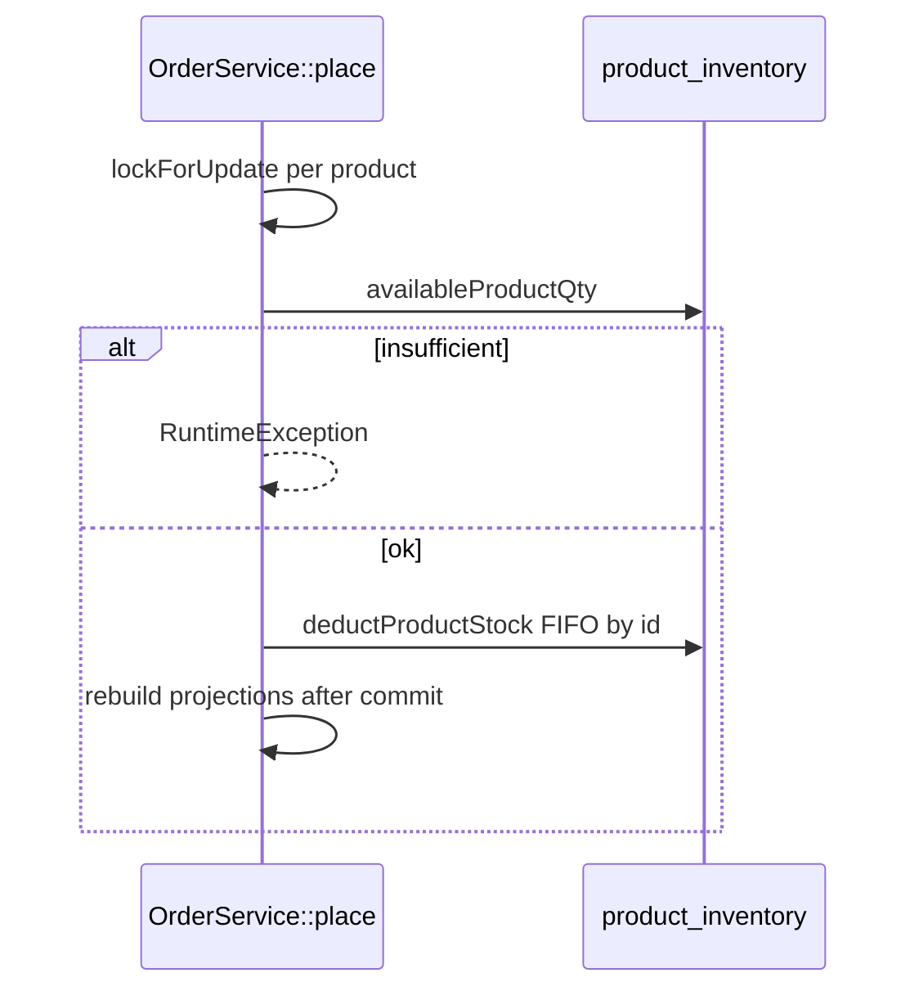

# Inventory operations (no owned services)

Back to [module README](README.md).

This module **owns no service, action, or repository class**. There is no `WarehouseService` or `InventoryService` under `app/Services`.

Stock is mutated and checked in other modules against `product_inventory`. This file records those operations only (do not treat it as catalog-products or checkout documentation).

---

## Catalog writes — `App\Services\Product\ProductService`

Source: `app/Services/Product/ProductService.php`

**Owned by:** catalog-products  
**Called by:** `ProductController::store` / `update` via `create()` / `update()`  
**Transaction:** `create` and `update` each wrap work in `DB::transaction`.

### `syncBundleComposition(Product $p, array $data, bool $isNewProduct)`

| Product type | Inventory effect |
| ------------ | ---------------- |
| bundle | `ProductInventory::where('product_id', $p->id)->delete()` then sync bundle items (no parent stock) |
| configurable | Same parent inventory delete, then `ConfigurableProductService::syncVariants()` |
| simple | `syncInventory($p, $data['inventory'] ?? [], $isNewProduct)`; clears stale bundle/configurable composition |

### `syncInventory(Product $p, array $rows, bool $isNewProduct = false)`

- New product and `$rows === []`: warehouse id = `Warehouse` where `is_default` true, else `Warehouse::query()->value('id')`. If found, `$rows = [['warehouse_id' => that id]]`.
- Skips rows without `warehouse_id`.
- Qty: if payload has non-empty `qty`, use it; else existing row qty; else if new product `Product::DEFAULT_NEW_STOCK_QTY` (`999`); else `0`.
- `reserved_qty`: payload value, else existing, else `0`.
- `ProductInventory::updateOrCreate` on `(product_id, warehouse_id)`.

Rows for warehouses **not** in `$rows` are **not** deleted on simple-product update.

---

## Catalog writes — `App\Services\Product\ConfigurableProductService`

Source: `app/Services/Product/ConfigurableProductService.php`

**Owned by:** catalog-products

### `syncVariants(Product $parent, array $data)`

Deletes `ProductInventory` for the **parent** again (`ProductInventory::where('product_id', $parent->id)->delete()`), then upserts children.

### `syncChildInventory(Product $child, array $rows)` (protected)

Called from `upsertChild()` as `syncChildInventory($child, $row['inventory'] ?? [])`.

Same qty / reserved / `updateOrCreate` rules as `ProductService::syncInventory`, with “new child” = `!$child->inventories()->exists()`. Empty `$rows` writes nothing.

Validation of request inventory: `StoreProductRequest` — `inventory.*.warehouse_id` `exists:warehouses,id`; variant inventory similarly. New variant without qty gets `DEFAULT_NEW_STOCK_QTY` in request normalization.

---

## Availability reads — catalog

### `App\Services\Product\BundleAvailabilityService`

Source: `app/Services/Product/BundleAvailabilityService.php`

**Owned by:** catalog-products

- `availableFromComponents`: `min(intdiv(available, required))`; empty components or any child `available <= 0` → `0`; `required <= 0` skipped.
- `availableQty(Product $bundle)`: loads `bundleItems.childProduct.inventories`; child available = sum of `qty - reserved_qty` (**no** `max(0)`).
- `isInStock`: `availableQty() > 0`.
- Non-bundle: `availableQty` returns `0`.

### `Product::availableQty()` / `isInStock()`

See [models.md](models.md). Bundles delegate here. Configurable parents return 1/0, not summed child qty.

### `App\Services\Product\ProductProjectionService`

Rebuild uses `$product->availableQty()` for projection `qty` and `in_stock` (`qty > 0`). Payload `inventory.in_stock` is built in `ProductPayloadBuilder`. After checkout deduct, `OrderService::rebuildProjectionsAfterCommit()` rebuilds affected products plus bundle/configurable parents.

### `App\Services\Product\ProductAdminFilterService::applyStock()`

SQL on **the listed product’s** `product_inventory` only:

```sql
COALESCE(SUM(pi.qty - pi.reserved_qty), 0)
```

| `filter_stock` | Predicate |
| -------------- | --------- |
| `in_stock` | available > 0 |
| `out_of_stock` | available ≤ 0 |
| `low_stock` | available > 0 AND ≤ `max(1, filter_low_stock_threshold)` (default 5) |

Bundles with no parent rows therefore match **out of stock** in this filter even when children have stock. List **display** uses `availableQty()` instead.

### `App\Services\Product\ProductAdminExportService`

`withSum` of this product’s `qty` / `reserved_qty`; available = `max(0, total - reserved)`.

### `App\Services\Product\ConfigurableProductService` payload

Variant `qty` in PDP matrix = `max(0, sum(qty - reserved_qty))`; `in_stock` = that sum `> 0`. Parent summary `in_stock` if any active child has availability.

### `App\Services\Product\RentalAvailabilityService::totalUnits()`

Sum of `inventories.qty` across warehouses (**not** minus `reserved_qty`). Calendar occupancy is `RentalReservation`, not this table.

---

## Checkout — `App\Services\Checkout\OrderService`

Source: `app/Services/Checkout/OrderService.php`

**Owned by:** cart-checkout  
**Called by:** place-order flow  
**Transaction:** entire `place()` is `DB::transaction`.



### `availableProductQty(int $productId): int`

`ProductInventory` for product, `lockForUpdate()`, sum of `max(0, qty - reserved_qty)`.

### Place-time checks (sale lines; rentals skipped)

- Bundle with no components: `RuntimeException("Bundle {$sku} has no components.")`
- Bundle: for each component, `childAvailable < line_qty * component.quantity` → `Insufficient stock for bundle {$sku} (component {$childSku}).`
- Non-bundle: `availableQty < line_qty` → `Insufficient stock for SKU {$sku}.`

### `deductProductStock(int $productId, int $qty, string $label): void`

- `$qty <= 0`: return.
- Rows `lockForUpdate()->orderBy('id')`.
- For each row, deduct `min(available, remaining)` from **`qty`**, `save()`.
- If leftover: `RuntimeException("Stock conflict detected while placing order for {$label}.")`.

Bundle lines deduct each child (`line_qty * bundle_item.quantity`). Simple (including variant children) deduct `item.product_id`. Parent bundle/configurable rows are not deducted.

`reserved_qty` is unchanged.

---

## Cart — `App\Services\Checkout\CartService`

Source: `app/Services/Checkout/CartService.php`

**Owned by:** cart-checkout

`assertBundleAvailability()`: if product is bundle and `requestedQty > product->availableQty()`, throws `Requested quantity exceeds available stock for {$sku}. Available: {$available}.`

Called from `addItem()` and `updateQty()` for non-rental lines. **No-op for simple products** (including configurable children). Simple stock is not checked until `OrderService::place()`.

---

## Orders — restock

### `OrderController::performCancel()` (orders module)

Inside `DB::transaction`. For each non-rental item, `restockableQtyOnCancel` is added to:

```text
ProductInventory::where('product_id', $item->product_id)->lockForUpdate()->first()
```

If missing, `new ProductInventory(['product_id' => $item->product_id, 'qty' => 0])` then increment and `save()`. `warehouse_id` is not set on that new instance; the column is non-nullable in the migration.

Restock target is the **order line product**, not exploded bundle children.

### `CreditNoteService` restock (checkout/orders)

When input `restock` is true: `ProductInventory::firstOrNew(['product_id' => $line['product_id']])`, add line qty, `save()`, set credit note `restocked`. No `warehouse_id` in the lookup key (multiple warehouse rows: first match).

---

## Low-stock mail (not triggered here)

| Class | Method | Notes |
| ----- | ------ | ----- |
| `App\Services\Mail\MailService` | `notifyAdminLowStock(Collection $items)` | Requires `notifications.admin.notify_low_stock`; queues `LowStockMail` |
| `App\Mail\Admin\LowStockMail` | — | `ShouldQueueAfterCommit`; to `notifications.admin.email`; view `emails.admin.low-stock` |

**No production caller** of `notifyAdminLowStock` was found. This module does not schedule or dispatch it. `TestMailCommand` (`admin-low-stock`) sends a fake `LowStockMail` directly.

---

## What this module does not implement

- No reservation lifecycle (`reserved_qty` is a stored integer written from admin/demo data).
- No warehouse-priority or channel-specific stock allocation (checkout sums all warehouses, deducts FIFO by row id).
- No dedicated inventory admin screen (qty is on the product form).
