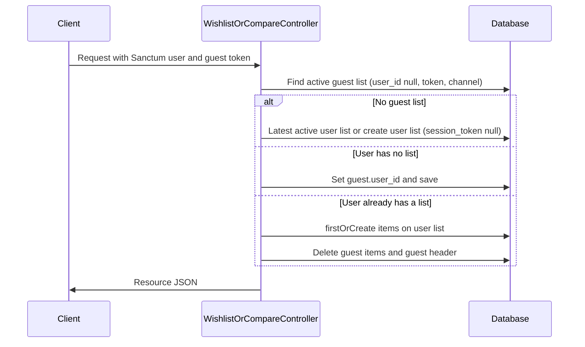

# Controllers

Back to [README](README.md). Routes: [routes.md](routes.md). API: [api.md](api.md).

Both controllers extend `App\Http\Controllers\Controller`. They take no constructor injection. List identity, merge, and persistence are implemented as private methods on the controller (no service class). Eager load on every resource response:

```text
items.product.translations
items.product.images
items.product.prices
```

`Illuminate\Http\Resources\Json\JsonResource::withoutWrapping()` is not called in `AppServiceProvider`. Laravel therefore wraps resource `toArray()` output in a `data` key. `->additional(['meta' => …])` adds a sibling `meta` object.

No events, jobs, notifications, or `DB::transaction()` appear in these controllers.

---

## `App\Http\Controllers\Api\V1\WishlistController`

Source: `app/Http/Controllers/Api/V1/WishlistController.php`

### Responsibility

Storefront wishlist HTTP API: create/attach, show, add item, remove item, clear.

### Dependencies

- `App\Http\Resources\Api\V1\WishlistResource`
- `App\Models\Wishlist`, `App\Models\WishlistItem`
- `Illuminate\Http\Request`, `Illuminate\Support\Str`
- `app('currentChannel')` (set by `channel.api`)
- Sanctum: `$request->user('sanctum')`

### Shared private helpers

| Method | Behavior |
| ------ | -------- |
| `channelId()` | `(int) app('currentChannel')?->id` or `abort(400, 'Channel not resolved')` |
| `userId(Request)` | `$request->user('sanctum')?->id` |
| `extractToken(Request)` | Header `X-Wishlist-Token`, else query `wishlist_token` |
| `latestActiveUserWishlist(int $userId)` | `channel_id` + `user_id` + `status = active`, `latest('updated_at')`, `latest('id')` |
| `createWishlistModel(?int $userId, ?string $token)` | `Wishlist::create` with `status = active`, `items_count = 0` |
| `getOrCreateGuestWishlist(string $token)` | `firstOrCreate` on `channel_id`, `session_token`, `status = active`; defaults `user_id = null`, `items_count = 0` |
| `attachGuestWishlistToUser(int $userId, string $token)` | See merge flow below |
| `getWishlist(Request)` | User path: merge then latest-or-create (token `null` on create). Guest: `getOrCreateGuestWishlist` (generates UUID if token missing) |
| `findActiveWishlist(Request)` | User: latest active user list (no create). Guest: requires token; finds active guest list. Otherwise `null` |

Guest merge (`attachGuestWishlistToUser`):

1. Load active guest wishlist: same channel, `user_id` null, matching `session_token`.
2. If none, return `false`.
3. If the user has no active list, set `guest.user_id` and save; return `true`.
4. Else copy guest `product_id`s onto the user list via `WishlistItem::firstOrCreate`, refresh `items_count`, delete guest items, delete guest row.

### `create()`

- Route: `POST /api/v1/wishlist`
- Authentication: optional Sanctum
- Permissions: none
- Validation: none
- Side effects: may create a wishlist; may merge guest into user
- Response: `WishlistResource` plus `meta.wishlist_token` = `$wishlist->session_token ?: $token`
- For a newly created **user** list, `session_token` is `null`, so `meta.wishlist_token` is the request token or the generated UUID (not stored on the row)

### `show()`

- Route: `GET /api/v1/wishlist`
- Same attach/get-or-create path as `create()` (duplicated, not delegated to `getWishlist()`)
- Response: `WishlistResource` plus `meta.wishlist_token` = `$wishlist->session_token` **only** (no `?: $token` fallback). User lists with a null token therefore return a null `meta.wishlist_token`

### `addItem()`

- Route: `POST /api/v1/wishlist/items`
- Validation: `product_id` required integer `exists:products,id` (inline; see [requests-validation.md](requests-validation.md))
- Resolves list via `getWishlist()` (creates guest/user list if needed)
- `WishlistItem::firstOrCreate` on `wishlist_id` + `product_id`
- Updates `items_count`
- Response: `WishlistResource` with **no** `meta` additional payload
- Events/jobs: none

### `removeItem(Request $request, int $id)`

- Route: `DELETE /api/v1/wishlist/items/{id}`
- `{id}` is `wishlist_items.id`, not `product_id`
- Deletes `$wishlist->items()->where('id', $id)` (0 rows is not treated as an error)
- Updates `items_count`
- Response: `WishlistResource` without `meta`

### `clear()`

- Route: `DELETE /api/v1/wishlist`
- Uses `findActiveWishlist()` — **does not create** a list
- If none: JSON `{ success: true, message: 'No active wishlist to clear.' }`
- Else: delete items; set `items_count = 0` and `status = 'active'`
- Response: `{ success: true, message: 'Wishlist cleared.' }`
- Does not return `WishlistResource`

---

## `App\Http\Controllers\Api\V1\CompareController`

Source: `app/Http/Controllers/Api/V1/CompareController.php`

### Responsibility

Storefront compare-list HTTP API. Structure parallels `WishlistController` with the differences called out below.

### Dependencies

- `App\Http\Resources\Api\V1\CompareResource`
- `App\Models\Compare`, `App\Models\CompareItem`
- Same channel / Sanctum / `Str` usage as wishlist
- Token: header `X-Compare-Token` or query `compare_token`

Private helpers are named `latestActiveUserCompare`, `createCompareModel`, `getOrCreateGuestCompare`, `attachGuestCompareToUser`, `getCompare`, `findActiveCompare`. Merge rules match wishlist (copy `product_id`s with `CompareItem::firstOrCreate`, then delete guest items and guest row).

### `create()`

- Route: `POST /api/v1/compare`
- Same guest/user branching as wishlist `create()`
- Response: `CompareResource` plus `meta.compare_token` = `$compare->session_token ?: $token`

### `show()`

- Route: `GET /api/v1/compare`
- Uses `getCompare()` (unlike wishlist `show()`, which inlines create/attach)
- Guest missing token still generates a UUID and `firstOrCreate`s a guest list
- Response: `CompareResource` plus `meta.compare_token` = `$compare->session_token` only (no fallback)

### `addItem()` / `removeItem()`

Same pattern as wishlist: `exists:products,id`; `firstOrCreate` / delete by item `id`; refresh `items_count`; return `CompareResource` without `meta`.

### `clear()`

- Route: `DELETE /api/v1/compare`
- `findActiveCompare()`; no-op JSON `No active compare to clear.`
- Deletes items; sets `items_count = 0`; **does not** write `status`
- Success JSON: `Compare cleared.`

---

## Resources used by the controllers

### `App\Http\Resources\Api\V1\WishlistResource`

Source: `app/Http/Resources/Api/V1/WishlistResource.php`

`toArray()` fields: `id`, `items_count` (int), `items[]`, `created_at` / `updated_at` as ISO-8601.

Each item: `id`, `product_id` (from the item row), `sku`, `name`, `slug`, `unit_price`, `price`, `final_price`, `image`, `image_url` (same resolved string or null).

`name` / `slug`: first loaded translation, else `$product->name` / `$product->slug`, else `''`.

Prices: `Product::priceForChannel()` → `price`; `Product::effectivePrice()` (or that `price` if effective is 0/empty) → `unit_price` and `final_price`. Missing product → `[0.0, 0.0]`.

Image: first `images` row with `is_primary`, else first image; then first non-empty string among image `url`, `image_url`, `path`, `file_path`, `image`, `src`, then product `image_url`, `image`, `thumbnail`, `thumbnail_url`.

### `App\Http\Resources\Api\V1\CompareResource`

Source: `app/Http/Resources/Api/V1/CompareResource.php`

Same list envelope (`id`, `items_count`, `items`, timestamps). Same price and image helpers.

Item extras vs wishlist: `product_id` is `$product?->id` (not `$item->product_id`); `type`; `short_description` / `description` from first translation (else `''`); `images[]` with `url` / `alt` / `is_primary`; `inventory.is_in_stock`; `rating.avg` / `rating.count`. See [models.md](models.md) for the `inventory` / `rating` key mismatch with `Product`.

---

## Flow: guest merge into user list


