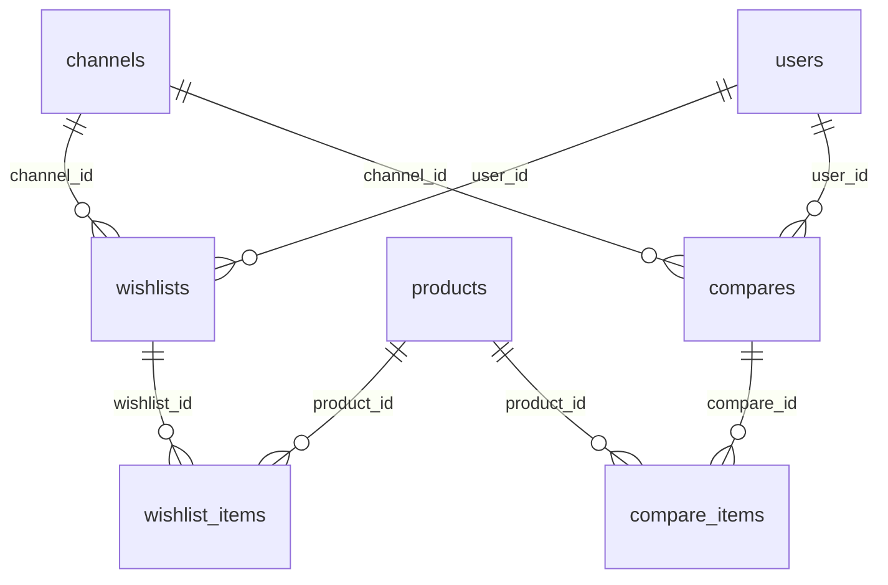

# Database

Back to [README](README.md). Models: [models.md](models.md).

Migrations are the source of truth for column types. No later migrations in this repository alter these four tables. No factories or seeders exist for them.

`channels`, `users`, and `products` are owned by other modules. Inverse Eloquent relations from those models are not declared.

---

## Table: `wishlists`

### Purpose

Wishlist header (guest token and/or user) for one channel.

### Columns

| Column | Type | Nullable | Default | Description |
| ------ | ---- | -------- | ------- | ----------- |
| `id` | bigint, PK | no | auto | Primary key |
| `channel_id` | foreignId | yes | null | `constrained()` → `channels.id`, `nullOnDelete()` |
| `user_id` | foreignId | yes | null | `constrained()` → `users.id`, `nullOnDelete()` |
| `session_token` | uuid | yes | null | Unique when non-null |
| `status` | string | no | `active` | Controller queries `active` |
| `items_count` | unsignedInteger | no | `0` | Denormalized item count |
| `created_at` | timestamp | yes | | Laravel |
| `updated_at` | timestamp | yes | | Laravel |

### Primary Key

`id`

### Foreign Keys

| Column | References | On delete |
| ------ | ---------- | --------- |
| `channel_id` | `channels.id` | SET NULL (`nullOnDelete`) |
| `user_id` | `users.id` | SET NULL (`nullOnDelete`) |

### Indexes / Unique Constraints

- Unique: `session_token`
- FK indexes as created by `foreignId()->constrained()`

### Relationships

- Has many `wishlist_items`
- Belongs to `users` / `channels` at the database level

### Created By

`database/migrations/2026_05_10_172102_create_wishlists_table.php`

---

## Table: `wishlist_items`

### Purpose

Product membership on a wishlist. One row per product per wishlist.

### Columns

| Column | Type | Nullable | Default | Description |
| ------ | ---- | -------- | ------- | ----------- |
| `id` | bigint, PK | no | auto | Item id exposed in the API |
| `wishlist_id` | foreignId | no | | `constrained()` → `wishlists.id`, `cascadeOnDelete()` |
| `product_id` | foreignId | no | | `constrained()` → `products.id`, `cascadeOnDelete()` |
| `created_at` | timestamp | yes | | Laravel |
| `updated_at` | timestamp | yes | | Laravel |

### Primary Key

`id`

### Foreign Keys

| Column | References | On delete |
| ------ | ---------- | --------- |
| `wishlist_id` | `wishlists.id` | CASCADE |
| `product_id` | `products.id` | CASCADE |

### Indexes / Unique Constraints

- Unique: `(wishlist_id, product_id)`

### Relationships

- Belongs to `wishlists` and `products`

### Created By

`database/migrations/2026_05_10_172214_create_wishlist_items_table.php`

---

## Table: `compares`

### Purpose

Compare-list header. Column set matches `wishlists`.

### Columns

| Column | Type | Nullable | Default | Description |
| ------ | ---- | -------- | ------- | ----------- |
| `id` | bigint, PK | no | auto | Primary key |
| `channel_id` | foreignId | yes | null | `constrained()` → `channels.id`, `nullOnDelete()` |
| `user_id` | foreignId | yes | null | `constrained()` → `users.id`, `nullOnDelete()` |
| `session_token` | uuid | yes | null | Unique when non-null |
| `status` | string | no | `active` | Controller queries `active` |
| `items_count` | unsignedInteger | no | `0` | Denormalized item count |
| `created_at` | timestamp | yes | | Laravel |
| `updated_at` | timestamp | yes | | Laravel |

### Primary Key

`id`

### Foreign Keys

| Column | References | On delete |
| ------ | ---------- | --------- |
| `channel_id` | `channels.id` | SET NULL (`nullOnDelete`) |
| `user_id` | `users.id` | SET NULL (`nullOnDelete`) |

### Indexes / Unique Constraints

- Unique: `session_token`
- FK indexes as created by `foreignId()->constrained()`

### Relationships

- Has many `compare_items`

### Created By

`database/migrations/2026_05_10_174236_create_compares_table.php`

---

## Table: `compare_items`

### Purpose

Product membership on a compare list. One row per product per compare list.

### Columns

| Column | Type | Nullable | Default | Description |
| ------ | ---- | -------- | ------- | ----------- |
| `id` | bigint, PK | no | auto | Item id exposed in the API |
| `compare_id` | foreignId | no | | `constrained()` → `compares.id`, `cascadeOnDelete()` |
| `product_id` | foreignId | no | | `constrained()` → `products.id`, `cascadeOnDelete()` |
| `created_at` | timestamp | yes | | Laravel |
| `updated_at` | timestamp | yes | | Laravel |

### Primary Key

`id`

### Foreign Keys

| Column | References | On delete |
| ------ | ---------- | --------- |
| `compare_id` | `compares.id` | CASCADE |
| `product_id` | `products.id` | CASCADE |

### Indexes / Unique Constraints

- Unique: `(compare_id, product_id)`

### Relationships

- Belongs to `compares` and `products`

### Created By

`database/migrations/2026_05_10_174327_create_compare_items_table.php`

---

## Notes from usage (not extra migrations)

- `session_token` uniqueness is **global**, not per channel. Guest `firstOrCreate` lookup keys are `channel_id` + `session_token` + `status = 'active'`. This module never writes a non-`active` status, so the extra `status` lookup key does not currently diverge from the unique column.
- Guest `clear` leaves the header row in place (items deleted, `items_count` 0).
- Deleting a product cascades to wishlist/compare item rows. Deleting a user/channel sets `user_id` / `channel_id` to null on remaining header rows.
