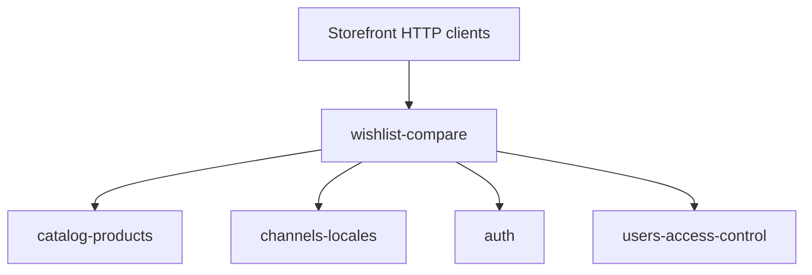

# Dependencies

Back to [README](README.md).

```text
wishlist-compare
├── depends on
│   ├── catalog-products
│   ├── channels-locales
│   ├── auth (optional Sanctum identity)
│   └── users-access-control (users table / User model FK)
│
└── consumed by
    └── storefront HTTP clients (outside app/; notes in docs-storefront/)
```



---

## Outgoing (verified in this module's PHP)

### catalog-products — confirmed

| Reference | Where |
| --------- | ----- |
| `exists:products,id` | `WishlistController::addItem`, `CompareController::addItem` |
| `product_id` FK | `wishlist_items`, `compare_items` migrations |
| `WishlistItem::product()`, `CompareItem::product()` | `belongsTo(Product::class)` |
| Eager load `items.product.translations`, `images`, `prices` | Both API controllers |
| `Product::priceForChannel()`, `Product::effectivePrice()` | `WishlistResource`, `CompareResource` |
| `ProductTranslation` name/slug/descriptions via `translations->first()` | Both resources |
| `ProductImage` (`is_primary`, `path`/`alt`, etc.) | Both resources' `resolveImage` |

This module does not call product projection/search services. It does not restrict `product_id` by `catalog_enabled`, `status`, channel assignment, or product type.

### channels-locales — confirmed

| Reference | Where |
| --------- | ----- |
| Middleware `channel.api`, `locale.api` | `routes/api.php` `v1` group |
| `app('currentChannel')?->id` | `channelId()` on both controllers |
| `channel_id` column + FK | `wishlists`, `compares` migrations |
| `ResolveApiChannel` | Bound as `channel.api` in `bootstrap/app.php` |
| `SetLocaleFromRequest` | Bound as `locale.api`; sets locale but resources do not filter translations by it |

### auth — confirmed (optional)

| Reference | Where |
| --------- | ----- |
| `$request->user('sanctum')` | `userId()` on both controllers |
| Routes **without** `auth:sanctum` | Public `v1` group in `routes/api.php` |

Login/register themselves are owned by [auth](../auth/README.md).

### users-access-control — confirmed (FK / User model)

| Reference | Where |
| --------- | ----- |
| `user_id` FK → `users.id` `nullOnDelete` | Both header-table migrations |
| `Wishlist::user()`, `Compare::user()` | `belongsTo(User::class)` |

`App\Models\User` does not declare `wishlists()` / `compares()`.

---

## Related but not a PHP dependency of these controllers

| Module / path | Observation |
| ------------- | ----------- |
| [settings-system](../settings-system/README.md) | `config/settings.php` `header.main.show_wishlist` (public boolean, default `true`). Not read by `WishlistController` or `CompareController`. No `show_compare` key in that file. |
| `docs-storefront/wishlist/README.md`, `docs-storefront/compare/README.md` | Next.js client notes in this repo; not Laravel source. |

---

## Incoming

No other classes under `app/` import `Wishlist`, `WishlistItem`, `Compare`, or `CompareItem` except this module's controllers. No observers, jobs, or CMS widget resolvers reference these models (repository search of `app/` for those class names is limited to this module plus the unused `ProductCompareController` import in `routes/api.php`).

Admin / web UI: none.

---

## Not present (do not invent)

- No wishlist/compare services, repositories, or actions
- No module-owned mail, notifications, or queues
- No Horizon / schedule entries for these tables
